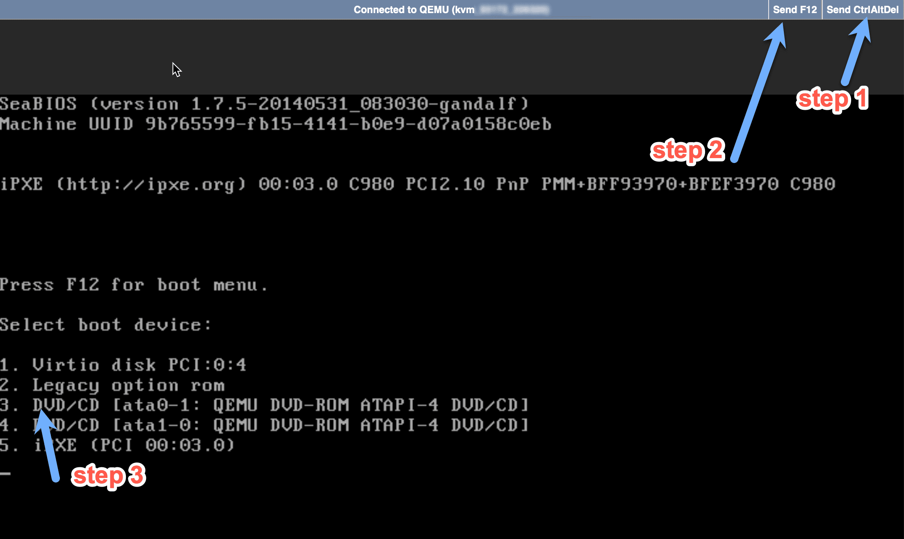
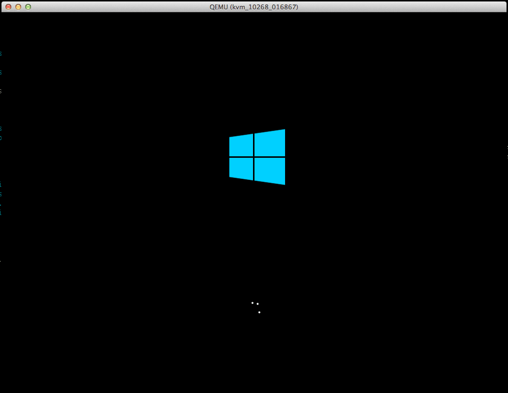
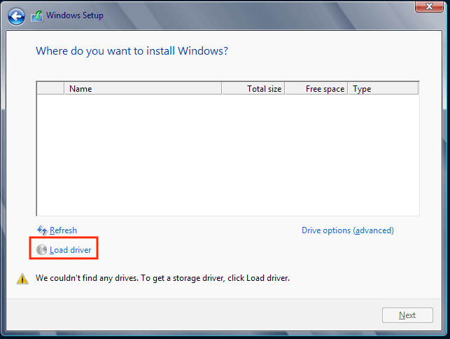
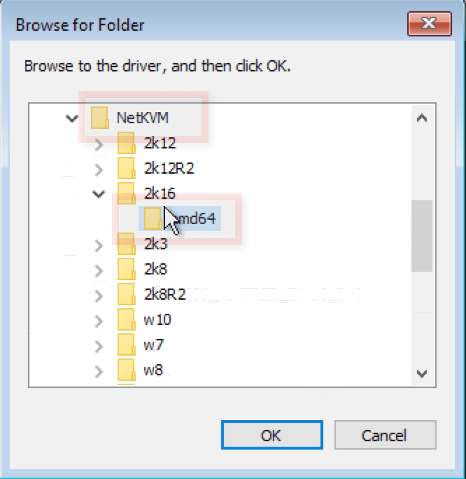
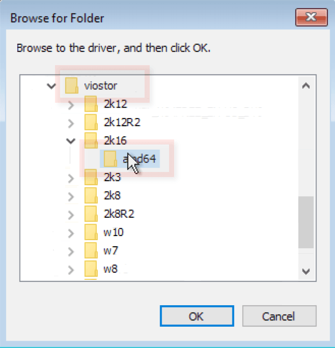
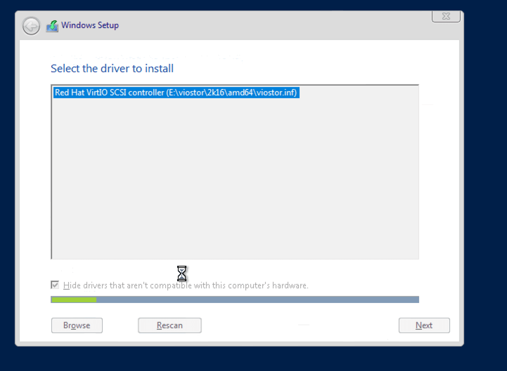

import { CtaButton } from "/snippets/cta-button.mdx";

## Только для ознакомления! {#for-illustration-purposes-only}

**Ручная** установка Windows Server на EDIS KVM через VNC.
Мы создали это руководство, чтобы описать процесс. Вы _можете_ попробовать его, если хотите поэкспериментировать. Для быстрой установки Windows или Linux используйте готовые автоустановщики.

EDIS предлагает установку Windows Server 2016, 2019 и 2022, а также Windows 10 в один клик. Устанавливать Windows вручную не требуется!

<CtaButton
  label="Автоустановка Linux/Windows"
  link="/ru/vps-management/autoinstall-reinstall-install-vps-linux-windows"
/>

Это руководство описывает **ручную установку** редакций Windows Server 2016, 2012 / R2, 2012, 2008, 2008 / R2. Оно **не подходит** для файла **Windows Desktop .iso**.

<Note>
**Минимальные системные требования:**

KVM VPS с 20 ГБ дискового пространства (KVM Starter и выше).

Лицензия Windows (2016, 2012 R2, 2012, 2008, 2008 R2) для активации.

Клиент VNC или сеанс noVNC из панели KVM.

</Note>

Руководство описывает ручную установку из образов Windows .iso, предоставляемых вместе с вашим VPS EDIS KVM.

## Установка {#installation}

<Steps>
  <Step title="Войдите в панель управления">
    [Панель управления VPS](https://manage.edisglobal.com/clientarea.php)
  </Step>
  <Step title="Подключите выбранный файл Windows .ISO" />
  <Step title="Включите VNC" />
  <Step title="KVM Settings → Disk driver → установите Virtio (значение по умолчанию)" />
  <Step title="KVM Settings → Network driver → установите Virtio (значение по умолчанию)" />
  <Step title="Запустите сеанс noVNC и выполните следующие действия" />
</Steps>

<Steps>
  <Step title="Отправьте CtrlAltDel (в правом верхнем углу окна noVNC)" />
  <Step title="Сразу после шага 1 отправьте F12 или нажмите Esc, чтобы открыть меню загрузки" />
  <Step title="Нажмите 3 для загрузки с подключённого .iso (DVD/CD)" />
</Steps>

Продолжайте установку до пустого экрана **Where do you want to install Windows?** («Где вы хотите установить Windows?»).

<Check>Всё в порядке. ;-)</Check>

Теперь загрузите драйверы диска и сети, предоставленные EDIS на диске E:

Загрузите клиентские драйверы Virtio.

Это необходимо для доступа к диску и сети.

Нажмите **Load driver** («Загрузить драйвер»), затем **Browse** («Обзор»).

Откройте диск с драйверами (обычно он подключён как `E:\`).

Выберите каталог драйверов для своей версии и архитектуры Windows (x64 = AMD64, x86 = X86).

- Для **Windows 2016** выберите папку **2k16**.
- Для **Windows 2012 / R2** выберите **2k12** или **2k12R2**.
- Для **Windows 2008 / R2** выберите **2k8** или **2k8R2**.

**Для Windows 2012 и новее доступны только 64-разрядные драйверы.**
Выберите подпапку AMD64.

Подтвердите выбор и нажмите **Next** («Далее»).

Повторите процесс для папки **viostor**.

Нажмите **Next** («Далее»).

Теперь раздел диска виден, и можно продолжить установку.

После завершения установки потребуется вручную настроить IP-адрес.

IP-адреса, маска подсети, адрес шлюза и DNS-серверы указаны в панели управления VPS.

Дополнительная установка драйверов не должна потребоваться.

Ваш Windows Server готов к работе.
