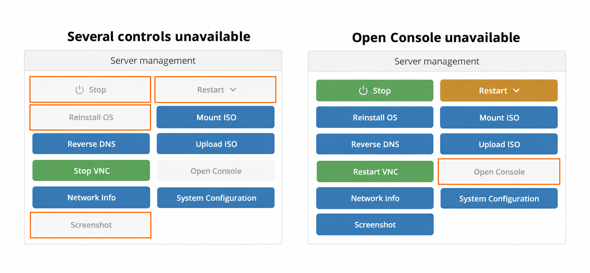

Если кнопки **Stop**, **Restart**, **Reinstall OS** или **Screenshot** остаются серыми после открытия VPS, возможно, панель не может получить его текущее состояние.

**Попробуйте другое подключение к интернету, смените сервер или провайдера VPN либо проверьте правила локального межсетевого экрана, которые могут блокировать доступ к серверам EDIS Global.** После каждого изменения перезагружайте страницу панели и проверяйте, стали ли кнопки доступны.

## Почему страница загружается, а некоторые кнопки — нет {#why-the-page-loads-but-some-buttons-do-not}

[Панель управления VPS](/ru/vps-management/vps-management-portal) загружает сведения об учётной записи и запрашивает актуальные данные сервера через API управления EDIS Global.

Браузер может загружать саму панель, даже если запросы к API не проходят. Когда панель не может подтвердить текущее состояние VPS, соответствующие элементы управления остаются недоступными. Например, перед предоставлением возможности переустановки ей нужно получить состояние сервера.

В результате страница может работать частично: некоторые кнопки отображаются нормально, а другие остаются серыми. Метка услуги **ACTIVE** или состояние **RUNNING** сами по себе не подтверждают успешность всех запросов актуальных данных.

<Note>
  Неактивные кнопки панели сами по себе не означают, что VPS выключен или его нужно переустановить.
</Note>

<Frame caption="Выделенные примеры: слева недоступны несколько элементов управления, справа — только Open Console. Данные клиентов удалены.">
  
</Frame>

## Восстановление доступа к элементам управления {#restore-access-to-the-controls}

<Steps>
  <Step title="Перезагрузите страницу услуги">
    Откройте [клиентскую панель](https://manage.edisglobal.com/clientarea.php), выберите **Services → My Services**, откройте свой VPS и перейдите в **Server Information**.

    Перезагрузите страницу один раз и дождитесь загрузки состояния. Проверьте, остаются ли несколько кнопок неактивными.
  </Step>

  <Step title="Попробуйте другое подключение">
    Откройте ту же страницу VPS через другое интернет-соединение, например мобильную точку доступа.

    Если вы уже используете VPN, попробуйте другой сервер или провайдера VPN либо подключитесь без VPN, если ваша сеть это позволяет. Если VPN не используется, доверенный VPN даст ещё один вариант подключения для проверки.

    После смены VPN или интернет-соединения перезагрузите страницу панели.

    Если кнопки стали доступны, это указывает на зависимость проблемы доступа к API управления от подключения. Сам по себе этот результат не устанавливает точную причину.
  </Step>

  <Step title="Проверьте фильтрацию в браузере и сети">
    Проверьте межсетевой экран компьютера, маршрутизатора или корпоративной сети: нет ли правил или записей о заблокированных соединениях с серверами EDIS Global. Локальный межсетевой экран, прокси или сетевой фильтр может разрешать открытие панели, но блокировать запросы состояния VPS.

    Если государственная интернет-фильтрация блокирует IP-адреса API EDIS Global, может помочь VPN. Выберите сервер VPN в локации, где эти адреса доступны, и перезагрузите панель.

    Если другое подключение работает, попросите сетевого администратора или интернет-провайдера разобраться в проблеме. Поддержка поможет определить затронутые запросы, чтобы вы могли проверить соответствующие правила, сохраняя межсетевой экран включённым.

    Чтобы проверить, связана ли проблема с браузером, попробуйте другой актуальный браузер на том же соединении.
  </Step>

  <Step title="Проверьте результат">
    Вернитесь в **Server Information** и убедитесь, что состояние загружается, а нужные элементы управления стали доступны.

    Не нужно нажимать **Stop**, **Restart** или **Reinstall OS** только ради проверки кнопки. Выполняйте действие лишь тогда, когда действительно хотите внести соответствующее изменение.
  </Step>
</Steps>

## Экстренное обходное решение: отключение автоматического опроса {#emergency-workaround-disable-automatic-polling}

Используйте `&polling=no` **только как временную экстренную меру**, если доступ к панели нужен срочно, а проблему подключения или межсетевого экрана пока не удалось устранить. Сначала выполните описанные выше проверки VPN, интернет-соединения и межсетевого экрана.

Если межсетевой экран на компьютере или в сети ограничивает повторные подключения к серверам EDIS Global, этот параметр может помочь. Он открывает страницу без автоматического обновления каждые несколько секунд и уменьшает число повторных запросов состояния.

<Warning>
  При отключённом опросе страница не обновляется автоматически. **После каждого изменения или действия вручную обновляйте страницу, чтобы увидеть актуальное состояние и элементы управления.** До обновления на странице может отображаться прежнее состояние.
</Warning>

Добавьте `&polling=no` к URL страницы VPS в адресной строке браузера.

Например, этот URL:

```text
https://manage.edisglobal.com/clientarea.php?action=productdetails&id=123456789
```

станет таким:

```text
https://manage.edisglobal.com/clientarea.php?action=productdetails&id=123456789&polling=no
```

Сохраните собственный ID услуги и все существующие параметры URL. Добавьте параметр перед фрагментом `#`, если он есть, и нажмите Enter. ID услуги выше приведён только для примера.

Если межсетевой экран полностью блокирует адрес назначения, сокращение частоты опроса может не помочь. Этот обходной способ не устраняет исходную проблему подключения или межсетевого экрана.

**Как можно скорее вернитесь к обычному режиму:** после устранения проблемы подключения удалите `&polling=no` и перезагрузите страницу, чтобы восстановить автоматический опрос.

## Если неактивна только кнопка Open Console {#if-only-open-console-is-greyed-out}

Доступность **Open Console** также зависит от VNC. Одна неактивная кнопка консоли ещё не означает, что панель испытывает описанную выше общую проблему подключения.

Следуйте [руководству по доступу VNC](/ru/vps-management/enable-vnc-server), чтобы включить VNC, и дождитесь доступности **Open Console**. Если VNC отображается как включённый, но консоль остаётся недоступной, обратитесь в поддержку и приложите снимок элементов управления и блока **Information**.

## Если проблема сохраняется {#if-the-problem-continues}

[Обратитесь в поддержку EDIS Global](https://www.edisglobal.com/contact), если кнопки остаются недоступными при разных подключениях или в разных браузерах.

Укажите:

- ID затронутой услуги VPS.
- Какие кнопки остаются серыми и загружается ли состояние.
- Браузер и операционную систему.
- Используете ли вы VPN, прокси или управляемую сеть.
- Примерное время возникновения проблемы и часовой пояс.
- Меняется ли результат при другом подключении или в другом браузере.
- Снимок экрана с неактивными элементами управления.

Скройте пароли и Support PIN на снимках экрана. Передавайте сведения об учётной записи только в переписке с поддержкой.

Доступные способы помощи описаны в статье [Как работает наша поддержка](/ru/getting-started/how-our-support-team-helps-you).
