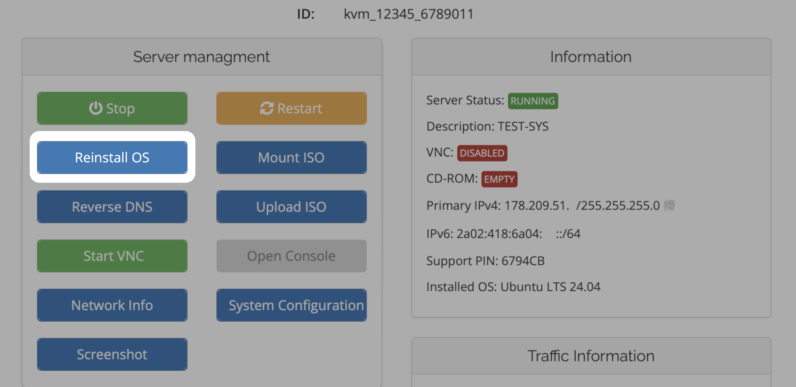
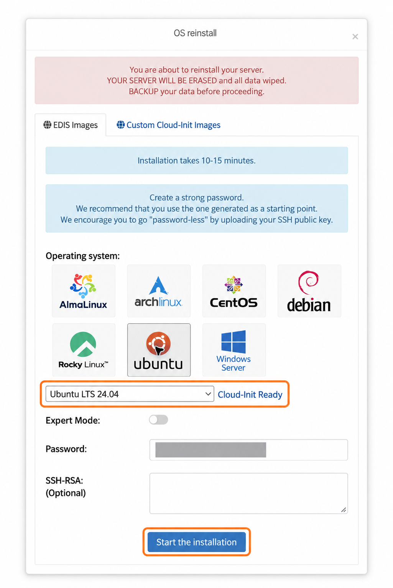

import { CtaButton } from "/snippets/cta-button.mdx";

## Можно ли позже бесплатно сменить операционную систему? {#can-i-change-my-operating-system-later-free-of-charge}

**Да. Переустановка ОС бесплатна.** Выбор операционной системы при заказе определяет только первоначальную установку. В любое время можно установить другую доступную ОС или версию через **Reinstall OS** в панели управления. Покупать новый VPS не нужно.

Например, можно перейти с **Debian 13 (Trixie)** на **Debian 12 (Bookworm)** или выбрать другой доступный дистрибутив Linux. См. [доступные операционные системы](/ru/vps-management/os-availability).

При смене ОС выполняется **чистая установка**. Существующие данные, приложения и настройки удаляются, поэтому заранее сохраните всё необходимое. Условия лицензирования и системные требования Windows действуют отдельно; платная лицензия Windows не включена.

## Переустановите VPS с чистой ОС {#reinstall-your-vps-with-a-fresh-os}

Установить чистую операционную систему на виртуальный сервер (VPS) можно за несколько нажатий.\
Независимо от того, переходите ли вы с Linux на Windows или хотите начать с чистой системы, функция **Reinstall OS** позволяет быстро и безопасно переустановить VPS.

> ⚠️ **Важно:** переустановка VPS безвозвратно удалит все данные.\
> Перед продолжением убедитесь, что у вас есть резервные копии.

---

## Видео: автоматическая установка Linux {#watch-linux-auto-install-video-guide}

Посмотрите короткое видео о переустановке VPS с Linux.\
Мы покажем основные шаги для успешной установки без затруднений.

<iframe width="100%" height="450" src="https://www.loom.com/embed/33e129dad9554baebb562b3e84e9527a?sid=1010322b-9466-416f-a135-19e0f07a8951" frameborder="0" allow="accelerometer; clipboard-write; encrypted-media; gyroscope; picture-in-picture" allowfullscreen />

---

## Видео: автоматическая установка Windows {#watch-windows-auto-install-video-guide}

В этом видео показана переустановка VPS с Windows Server (RDP).\
Узнайте, как запустить переустановку, задать пароль администратора и снова включить удалённый доступ.

<iframe width="100%" height="450" src="https://www.loom.com/embed/731fb25215a7488bb0463bd2c8d1fb16?sid=e7bd52c6-2f17-454e-991e-176c847de424" frameborder="0" allow="accelerometer; clipboard-write; encrypted-media; gyroscope; picture-in-picture" allowfullscreen />

---

## Пошаговая переустановка {#step-by-step-reinstallation}

<Steps>
  <Step title="Войдите в панель управления">
    Перейдите в [панель управления VPS](https://manage.edisglobal.com/clientarea.php) и откройте **Services → My Services**.
  </Step>
  <Step title="Найдите свой VPS">
    Выберите VPS для переустановки.
  </Step>
  <Step title="Нажмите Reinstall OS">
    Выберите семейство операционных систем, затем версию. При наличии поля открытого SSH-ключа проверьте его и при необходимости заполните. Задайте новый пароль.\
    Это будет пароль **root** в Linux или **Administrator** в Windows.

    > ⚠️ **Примечание:** EDIS Global не отправляет письмо с подтверждением при переустановке. Сохраните новый пароль в надёжном месте!
  </Step>
  <Step title="Запустите установку">
    Проверьте выбранный VPS, сохраните новый пароль и резервную копию данных, затем нажмите **Start installation**. Дождитесь завершения процесса перед повторным подключением.
  </Step>
</Steps>

<Frame caption="В этом примере пароль скрыт.">
  
</Frame>

---

## Время установки и доступность портов {#installation-time-and-port-behavior}

Дождитесь завершения автоматической настройки перед подключением. Обычное время установки:

<Columns cols={2}>
  <Card title="Linux" icon="terminal">
    

      ≈ 5
      минут
    

    **SSH · TCP-порт 22**

    Недоступен во время установки.
  </Card>
  <Card title="Windows" icon="desktop">
    

      ≈ 15
      минут
    

    **Удалённый рабочий стол · TCP-порт 3389**

    Недоступен во время установки.
  </Card>
</Columns>

Это приблизительное время. Недоступность SSH или RDP во время настройки ожидаема и сама по себе не означает сбой установки.

<Warning>
  **Не выключайте и не перезагружайте VPS и не запускайте повторную переустановку, пока установка не завершена.** Прерывание настройки может оставить операционную систему в незавершённом состоянии.
</Warning>

После завершения настройки подключитесь по [SSH к Linux](/ru/getting-started/linux-secure-shell-ssh) или через [удалённый рабочий стол к Windows](/ru/getting-started/windows-remote-desktop), используя пароль, заданный при переустановке. EDIS Global не отправляет новое письмо с учётными данными.

<Tip>
  После переустановки Linux SSH-ключ сервера может измениться. Если клиент сообщает **“REMOTE HOST IDENTIFICATION HAS CHANGED”**, выполните [проверку ключа сервера](/ru/getting-started/linux-secure-shell-ssh#remote-host-identification-has-changed) перед принятием нового ключа.
</Tip>

---

## Установка через Cloud-Init {#installation-via-cloud-init}

Если вы предпочитаете **собственный образ операционной системы**, EDIS Global также поддерживает установку через **Cloud-Init**.\
Этот способ подходит опытным пользователям, которые хотят **использовать собственный образ (BYO)**, например индивидуальный или готовый файл `.qcow2`. Затем пользовательские данные Cloud-Init автоматически настроят образ при первом запуске.

<Note>
  Используйте **Cloud-Init**, если нужно:\
  • развернуть собственный или заранее настроенный образ ОС\
  • автоматизировать создание пользователей, настройку SSH-ключей или команды первоначальной настройки\
  • полностью контролировать образ и конфигурацию сервера

  Если нужна просто чистая среда Linux или Windows, вариант **Reinstall OS** проще и быстрее.
</Note>

<CtaButton label="Установка ОС через Cloud-Init" link="/ru/advanced-setup-guides/installing-a-vps-using-cloud-init" />

