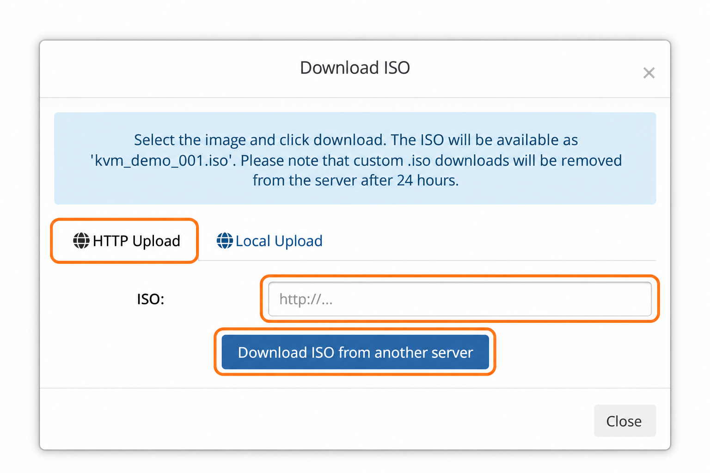
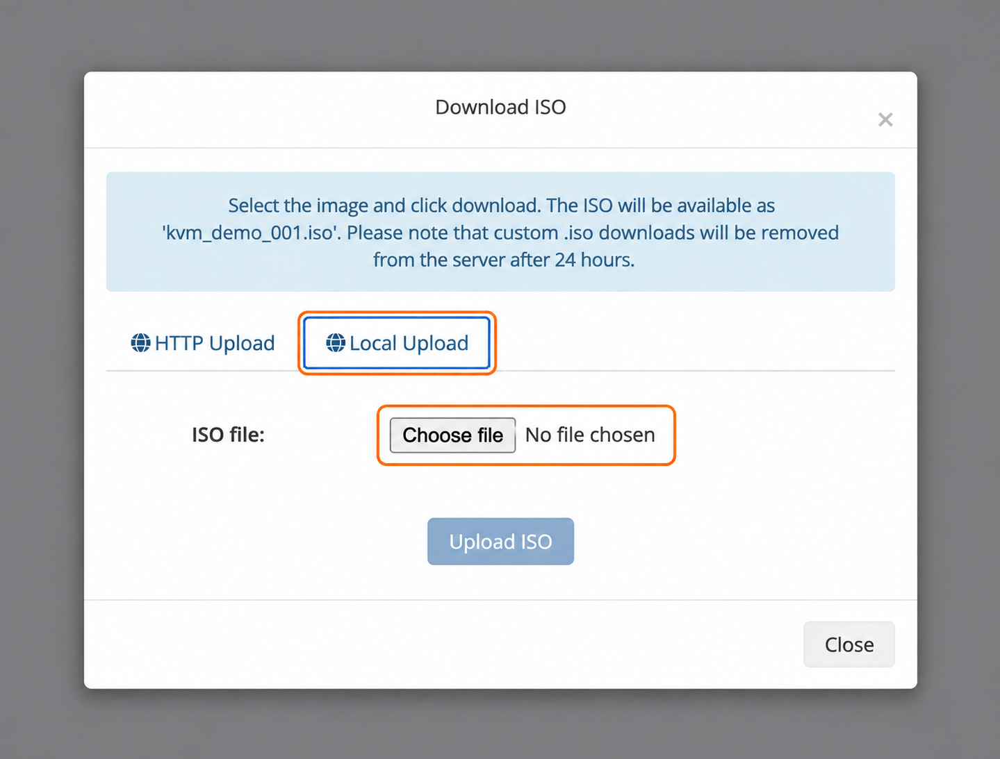

## Загрузите свой ISO {#upload-your-own-iso}

Используйте собственный ISO для ручной установки ОС или загрузки среды восстановления.

1. Откройте [панель управления VPS](https://manage.edisglobal.com/clientarea.php).
2. Откройте **Services → My Services** и выберите VPS.
3. На вкладке **Server Information** нажмите **Upload ISO** в блоке **Server management**. Окно называется **Download ISO**.

## Вариант 1: скачать по URL {#option-1-download-from-a-url}

Выберите **HTTP Upload**, введите прямой HTTP- или HTTPS-адрес ISO-файла и нажмите **Download ISO from another server**. Используйте ссылку на сам файл, а не на страницу скачивания. Дождитесь завершения загрузки.

<Frame caption="Сервер скачивает ISO по указанному URL.">
  
</Frame>

## Вариант 2: загрузить с компьютера {#option-2-upload-from-your-computer}

Выберите **Local Upload**, нажмите **Choose file** и выберите файл `.iso` на компьютере. Затем нажмите **Upload ISO** и дождитесь завершения передачи. Кнопка остаётся неактивной, пока файл не выбран.

<Frame caption="Выберите ISO-файл, чтобы активировать Upload ISO.">
  
</Frame>

## Подключите загруженный образ и загрузитесь с него {#mount-and-boot-the-uploaded-image}

После передачи закройте окно и откройте **Mount ISO**. Выберите имя собственного ISO, показанное для вашего VPS, затем следуйте [инструкции по подключению и загрузке](/ru/vps-management/mount-iso-image). Работайте с установщиком через [VNC / Open Console](/ru/vps-management/enable-vnc-server).

Сама загрузка или подключение ISO не устанавливает ОС. При выборе установки или разметки диска установщик может стереть диск VPS, поэтому заранее сохраните нужные данные.

<Note>
  Собственный ISO доступен **24 часа**, после чего удаляется. Панель назначает ему имя на основе ID VPS; оно может отличаться от исходного имени файла на компьютере.
</Note>
