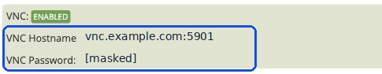

## Откройте консоль VPS {#open-the-vps-console}

VNC позволяет видеть экран VPS и использовать его клавиатуру, даже если SSH или RDP недоступны. **Open Console** запускает noVNC в браузере; также можно использовать настольный VNC-клиент.

1. Откройте [портал управления VPS](https://manage.edisglobal.com/clientarea.php).
2. Выберите **Services → My Services**, откройте VPS и перейдите в **Server Information**.
3. В разделе **Server management** нажмите **Start VNC**.
4. Дождитесь статуса **VNC: ENABLED** в панели **Information** и появления доступной кнопки **Open Console**.
5. Нажмите **Open Console**, затем щёлкните внутри окна консоли, чтобы ввод с клавиатуры поступал в неё.

<Frame caption="Чтобы включить VNC, нажмите Start VNC в разделе Server management.">
  
</Frame>

<Frame caption="После включения VNC кнопка Open Console становится доступной.">
  
</Frame>

## Можно ли копировать и вставлять текст? {#can-i-copy-and-paste-text}

**Браузерная консоль EDIS Global (noVNC) не поддерживает передачу буфера обмена между вашим компьютером и VPS.** Если нужно ввести текст, щёлкните внутри консоли и наберите его непосредственно с клавиатуры.

**Настольные VNC-клиенты поддерживают копирование и вставку текста**, если в клиенте включён общий буфер обмена и гостевой сеанс его поддерживает. Общий буфер может быть недоступен на экране входа, в текстовой консоли или во время загрузки.

## Вход через браузерную консоль {#log-in-through-the-browser-console}

На экране входа операционной системы используйте имя пользователя и пароль Linux или Windows. Отдельный **пароль VNC** предназначен для подключения настольным VNC-клиентом; это не пароль операционной системы, и для открытия браузерной консоли он не требуется.

## Подключение настольным VNC-клиентом {#connect-with-a-desktop-vnc-client}

Когда VNC включён, панель **Information** показывает имя хоста, порт и пароль VNC. Порт указан после двоеточия в поле **VNC Hostname**. Если в клиенте предусмотрены отдельные поля, введите имя хоста и порт отдельно. Когда клиент запросит пароль, введите пароль VNC из панели. После подключения на экране входа VPS используйте учётные данные операционной системы.

<Frame caption="Показаны примерные значения. Используйте имя хоста, порт и пароль VNC из своего портала.">
  
</Frame>

## Отключите VNC после работы {#stop-vnc-when-finished}

Закройте консоль или настольный клиент и нажмите **Stop VNC** в портале. Статус вернётся к **VNC: DISABLED**, а **Open Console** станет недоступной. Отключение VNC закрывает доступ к консоли, но не останавливает сам VPS.
