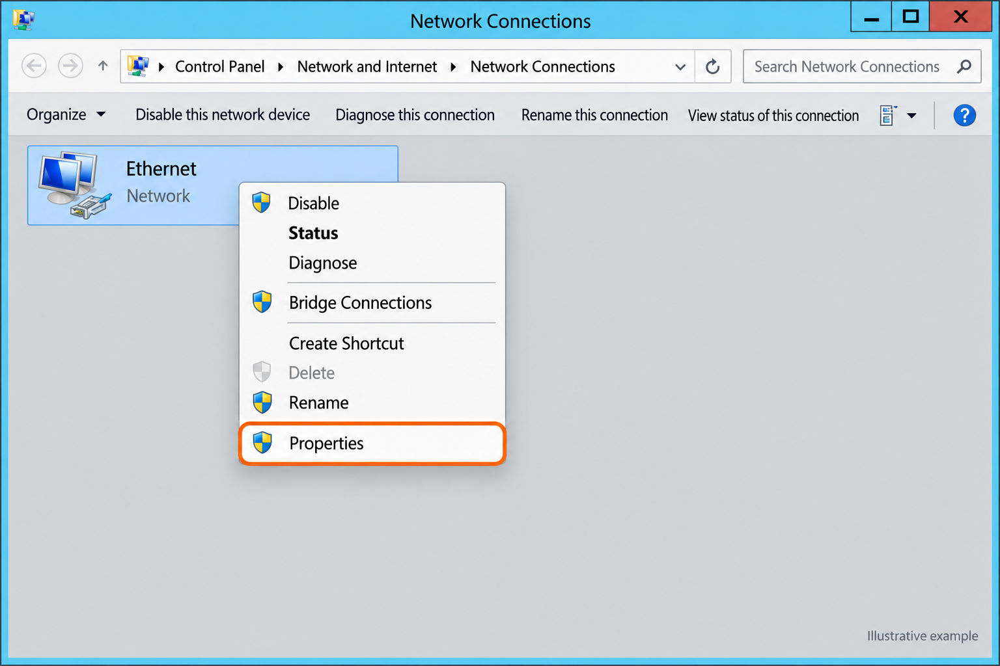
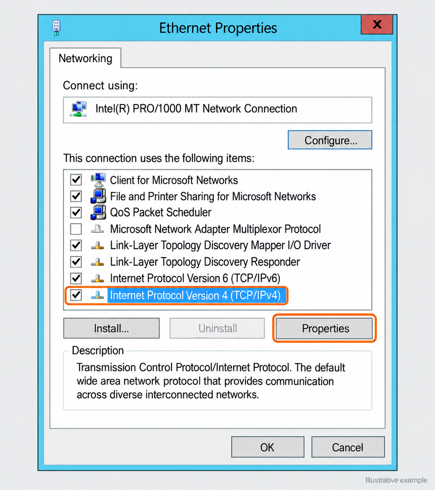
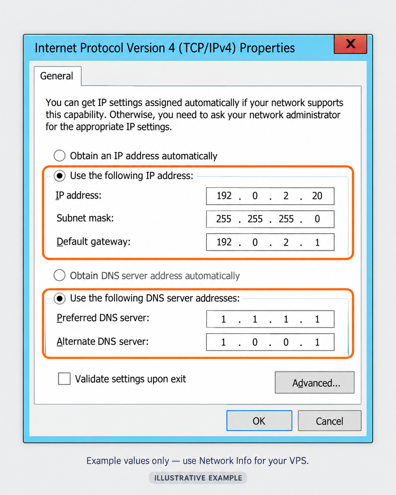

import { CtaButton } from "/snippets/cta-button.mdx";

## Краткое руководство по смене IP в Windows Server через VNC {#quick-guide-on-how-to-change-ip-address-on-windows-server-via-vnc}

Это руководство показывает, как настроить уже выделенный IPv4-адрес в Windows Server через VNC.

<Warning>
  Используйте IP-адрес, маску подсети, шлюз и DNS из [Network Info](/ru/vps-management/ip-address-information) своего VPS. Держите VNC открытым: смена адреса прерывает RDP. Снимки ниже — воссозданные примеры с адресами для документации; не копируйте их как настройки своего VPS.
</Warning>

Запишите текущие настройки перед изменением. В разных версиях Windows внешний вид и имена адаптеров могут немного отличаться.

## Изменение IP-адреса в Windows Server {#change-ip-address-on-windows-server}

### Шаг 1: подключитесь к Windows Server через VNC {#step-1-connect-to-your-windows-server-via-vnc}

<Steps>
  <Step title="Войдите в панель управления VPS">
    Откройте [панель управления VPS](https://manage.edisglobal.com/clientarea.php).
  </Step>
  <Step title="Включите VNC-сервер">
    Следуйте [инструкции по включению VNC](/ru/vps-management/enable-vnc-server).
  </Step>
  <Step title="Откройте VNC">
    Если Windows запрашивает сочетание клавиш, используйте **Send CtrlAltDelete** на панели VNC, затем войдите под учётной записью администратора.
  </Step>
</Steps>

---

### Шаг 2: откройте сетевые подключения {#step-2-open-network-connections}

1. После подключения нажмите правой кнопкой **Start** и выберите **Run**.
2. Введите `ncpa.cpl` и нажмите **Enter**. Откроется окно **Network Connections**.

---

### Шаг 3: откройте свойства сетевого адаптера {#step-3-access-properties-of-the-network-adapter}

1. В окне Network Connections найдите нужный сетевой адаптер, например Ethernet.
2. Нажмите на него правой кнопкой и выберите **Properties** в контекстном меню.

<Frame caption="Воссозданный пример: откройте Properties адаптера, подключённого к сети VPS.">
  
</Frame>

---

### Шаг 4: выберите версию интернет-протокола {#step-4-select-internet-protocol-version}

1. В окне свойств найдите и выберите **Internet Protocol Version 4 (TCP/IPv4)**.
2. Нажмите **Properties**.

<Frame caption="Выберите строку IPv4, затем Properties. Оставьте флажок протокола включённым.">
  
</Frame>

---

### Шаг 5: измените IP-адрес {#step-5-change-the-ip-address}

1. В окне TCP/IPv4 Properties выберите **Use the following IP address**.
2. Введите назначенные VPS **IP address**, **Subnet mask** и **Default gateway**. Возьмите все три значения из **Network Info**; не предполагайте, какими должны быть шлюз или маска.

На иллюстрации следующего шага `192.0.2.20`, `255.255.255.0` и `192.0.2.1` используются только для показа полей ввода.

---

### Шаг 6: настройте DNS-серверы (необязательно) {#step-6-configure-dns-servers-optional}

1. При необходимости выберите **Use the following DNS server addresses**.
2. Введите DNS-серверы, подходящие вашему VPS. На иллюстрации `1.1.1.1` и `1.0.0.1` служат примерами публичных DNS. Если сервер входит в домен Active Directory, сохраните требуемые DNS-серверы домена.

<Frame caption="IP-адреса только для документации. Введите настройки, назначенные вашему VPS.">
  
</Frame>

---

### Шаг 7: сохраните изменения {#step-7-save-changes}

1. Нажмите **OK**, чтобы закрыть окно TCP/IPv4 Properties.
2. Нажмите **Close** в окне свойств сетевого адаптера.

---

### Шаг 8: проверьте изменения {#step-8-verify-the-changes}

1. Откройте **Command Prompt** или **PowerShell** через контекстное меню кнопки Start.
2. Введите команду и нажмите **Enter**:
   `ipconfig`
3. Сравните IPv4-адрес, маску подсети и шлюз адаптера со значениями **Network Info**.
4. Со своего компьютера создайте новое RDP-подключение к новому IP. Не закрывайте VNC, пока подключение не заработает. Обновите DNS-записи и настройки приложений, которые ещё ссылаются на старый IP.

---

### Важные замечания {#important-notes}

- **Права администратора**: для изменения сетевых настроек требуются административные права. Убедитесь, что они у вас есть.
- **Сохранение настроек**: всегда записывайте предыдущие сетевые параметры перед изменением, чтобы при необходимости вернуться к ним.

---

#### Быстрый Windows VPS: готов за несколько минут {#fast-windows-vps-ready-in-minutes}

Запустите защищённый Windows VPS с 2 vCPU или больше. Мгновенная настройка, полный доступ администратора и надёжная производительность по всему миру.

Выберите локацию и тариф, укажите Windows при заказе и начните работу с полным RDP-доступом.

<CtaButton label="Запустить Windows VPS" link="https://www.edisglobal.com/windows-vps-hosting" />
