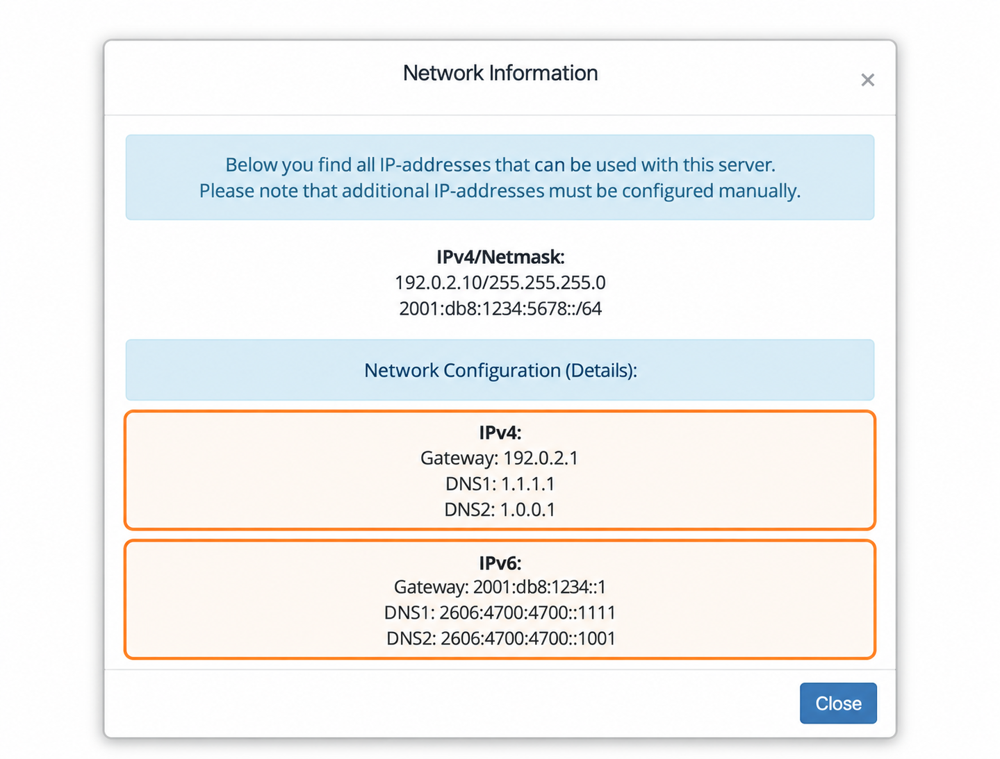

## Найдите сетевые настройки VPS {#find-your-vps-network-settings}

1. Откройте [панель управления VPS](https://manage.edisglobal.com/clientarea.php).
2. Перейдите в **Services → My Services** и выберите VPS.
3. На вкладке **Server Information** нажмите **Network Info** в блоке **Server management**.

<Frame caption="Адреса обезличены. Используйте значения, указанные для вашего VPS.">
  
</Frame>

В окне перечислены выделенный IPv4-адрес и маска сети, префикс IPv6, шлюзы и DNS-серверы. Используйте эти значения при настройке или восстановлении сети внутри ОС.

Просмотр окна не меняет сетевую конфигурацию гостевой ОС. Дополнительные IP-адреса также необходимо настроить внутри VPS. Для управления именами хостов, возвращаемыми для ваших адресов, см. [настройку обратного DNS](/faq/ip-addresses/setting-up-reverse-pointers).
