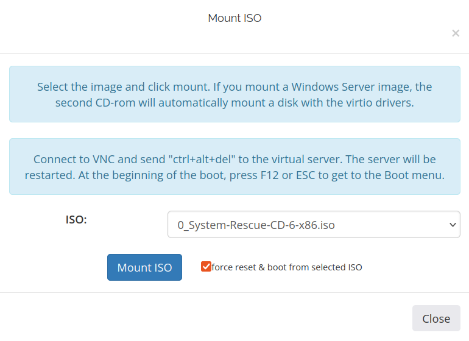
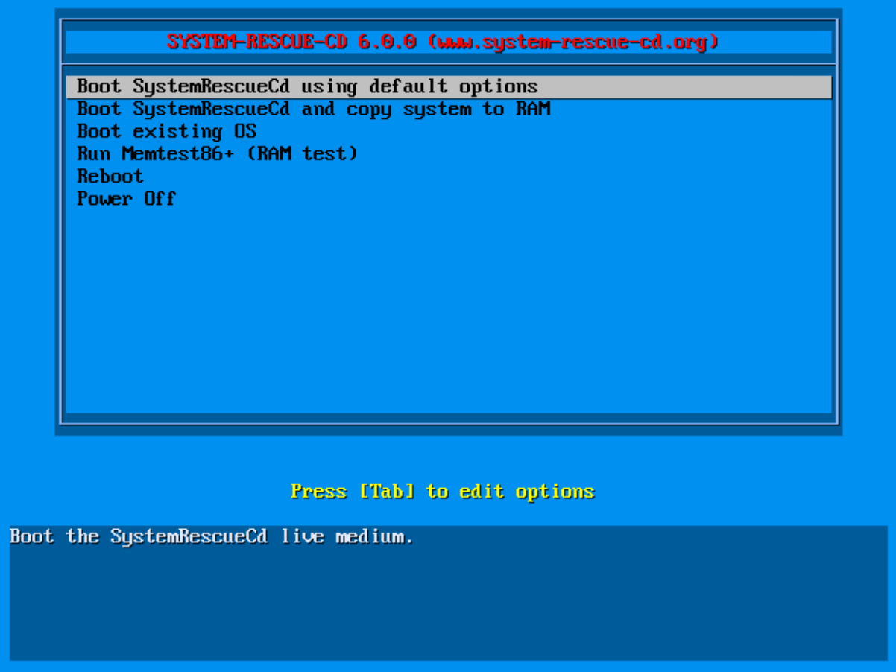
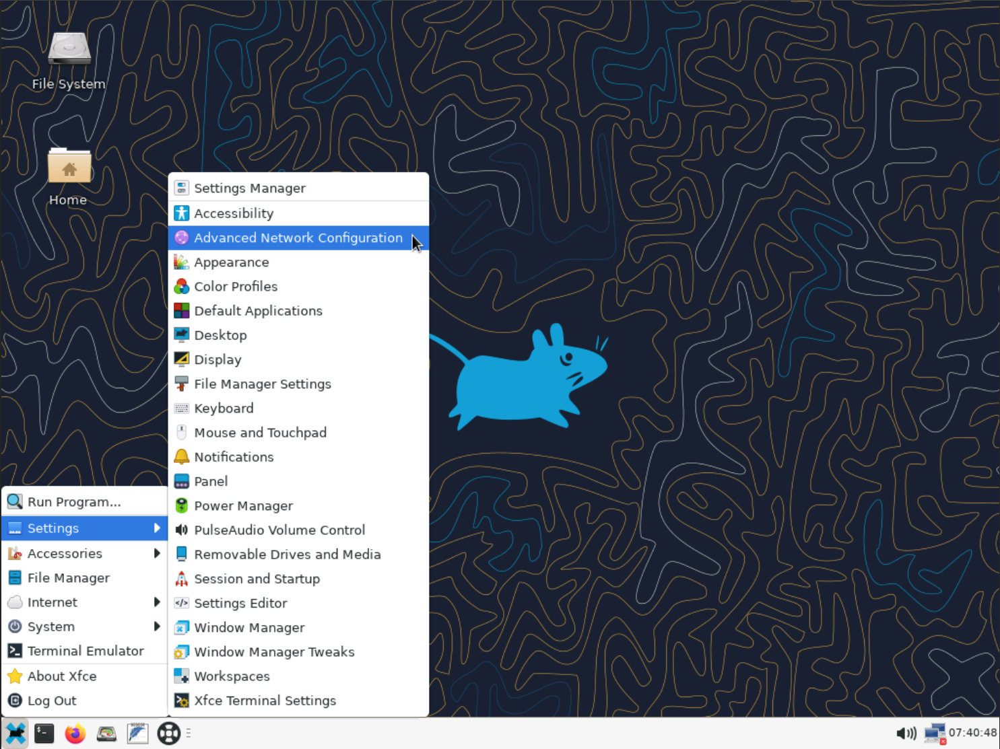
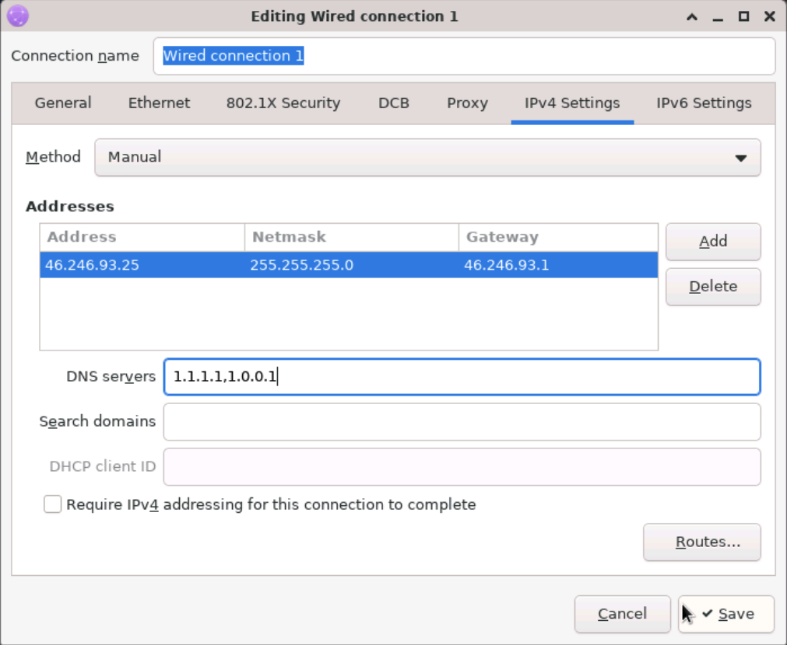
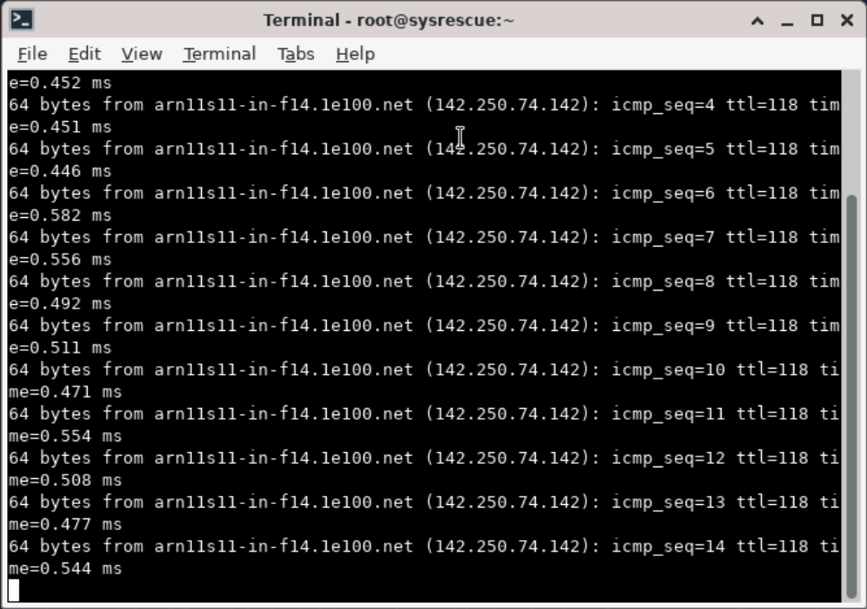
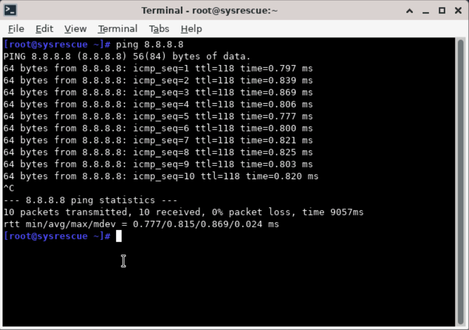
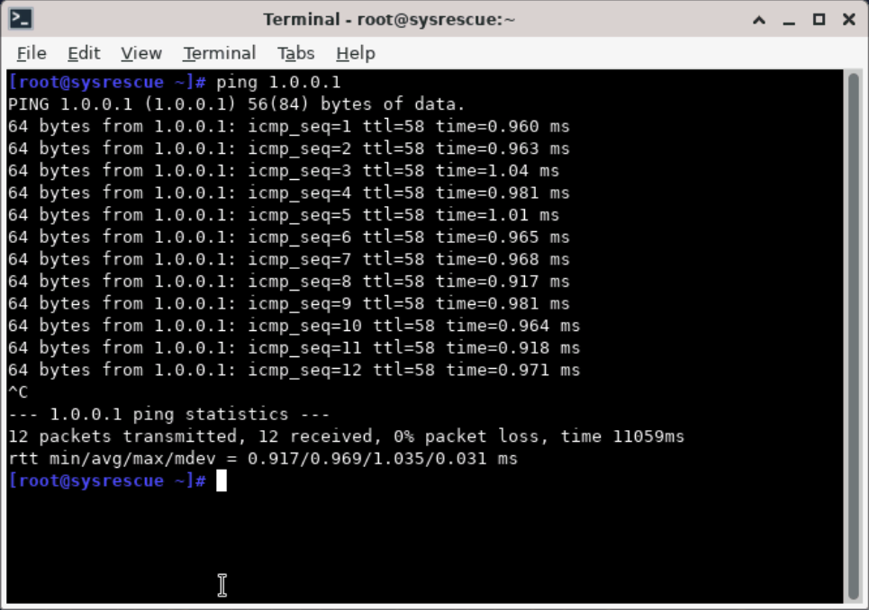
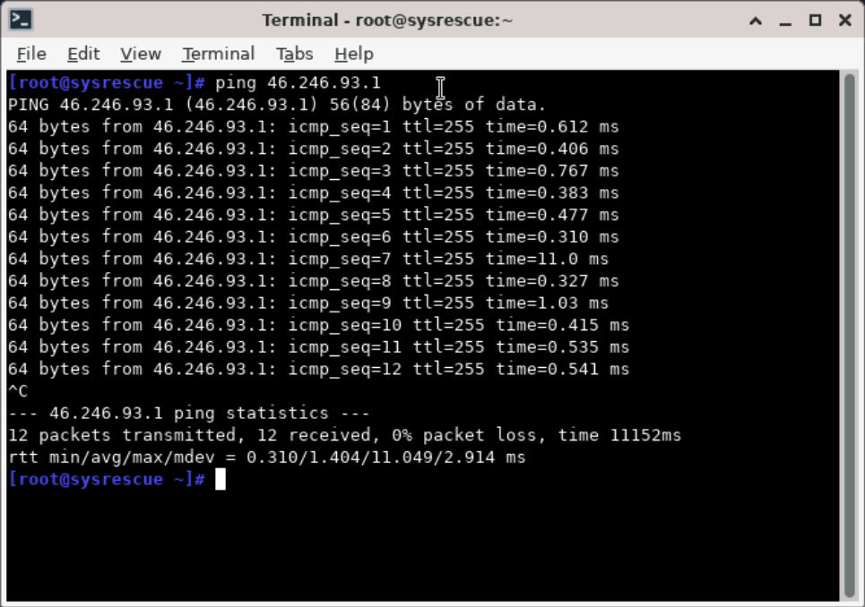

## Что такое Rescue CD и зачем он нужен? {#what-is-a-rescue-cd-and-why-use-it}

**SystemRescueCD** — загружаемая среда на основе Linux для диагностики и обслуживания. Она позволяет:
- Получать доступ к незагружающимся системам и восстанавливать их
- Проверять и исправлять проблемы диска, сети и межсетевого экрана
- Подключать разделы основной ОС и менять настройки
- Восстанавливать доступ, если SSH или правила межсетевого экрана блокируют подключения

---

## Подключите SystemRescueCD и загрузитесь с него {#mount-and-boot-the-systemrescuecd}

1. Войдите в [панель управления VPS](https://manage.edisglobal.com/clientarea.php).
2. В панели VPS нажмите **Mount ISO**.
3. В списке ISO выберите **System-Rescue-CD-6-x86.iso**.
4. Включите **force reset & boot** и нажмите **Mount ISO**, чтобы начать.

   

5. После подключения нажмите **Start VNC**, затем **Open Console** для доступа к консоли.
6. В загрузочном меню выберите **Boot SystemRescueCd using default options** и нажмите **Enter**.

   

7. Если загрузилась командная строка, запустите графический рабочий стол вручную:

   ```bash
   startx
   ```

---

## Настройте сеть в режиме восстановления {#configure-network-in-rescue-mode}

Сеть можно настроить через графический интерфейс — это проще всего — или командную строку.

### Через графический интерфейс {#using-the-graphical-interface}

1. Откройте **Settings → Advanced Network Configuration**.


2. Выберите проводной интерфейс, например *Wired connection 1*.

3. Нажмите значок **шестерёнки** ⚙️, чтобы открыть настройки.
.png)

4. Вкладка **IPv4** → **Method: Manual** → **Add**: добавьте IP, маску сети и **свой фактический шлюз**.

5. **DNS**: например, `1.1.1.1, 1.0.0.1` → **Save**.


Назначенные IP-настройки доступны в разделе [Настройки IP-адресов VPS](/ru/vps-management/ip-address-information).

**Быстрые проверки подключения:**

~~~bash
ping -c 3 8.8.8.8
ping -c 3 1.1.1.1
ping -c 3 YOUR_GATEWAY   # replace with your real gateway
ping -c 3 google.com       # DNS + outbound test
~~~

**Снимки результатов ping:**

|  |  |
|:--:|:--:|
|  |  |

---

### Через командную строку (если графический интерфейс недоступен) {#using-command-line-if-gui-not-available}

Если вы работаете в командной строке:

~~~bash
ip a                            # identify the interface (eth0 / ens3)
ip addr add YOUR_IP/PREFIX_LENGTH dev eth0
ip route add default via YOUR_GATEWAY

echo "nameserver 1.1.1.1" > /etc/resolv.conf
echo "nameserver 8.8.8.8" >> /etc/resolv.conf

ping -c 4 8.8.8.8
ping -c 4 YOUR_GATEWAY
ping -c 4 google.com
~~~

---

<Note>
  Сеть, настроенная в среде восстановления, действует временно и не исправляет конфигурацию установленной ОС на диске. Перед редактированием её файлов определите корневую файловую систему установленной системы; `/dev/vda1` ниже — пример, а не гарантированная схема разделов.
</Note>

## Проверьте межсетевой экран из режима восстановления {#check-the-firewall-from-rescue-mode}

Если вы работаете в графической среде, сначала откройте **Terminal**.

При загрузке Rescue CD его внутренний межсетевой экран (iptables или nftables) обычно отключён.  
Чтобы проверить или изменить межсетевой экран **основной системы**, выполните следующие шаги:

1. Определите и подключите основной раздел:

~~~bash
lsblk
mkdir -p /mnt/system
mount /dev/vda1 /mnt/system
# Replace /dev/vda1 with your actual root partition.
~~~

2. Проверьте, был ли включён UFW:

~~~bash
cat /mnt/system/etc/ufw/ufw.conf
# look for: ENABLED=yes
~~~

3. Изучите правила:

~~~bash
cat /mnt/system/etc/ufw/user.rules
# or, for iptables-persistent:
cat /mnt/system/etc/iptables/rules.v4
~~~

4. Сохраните копию любого файла конфигурации перед редактированием. Проверьте правила IPv4 и IPv6: `user.rules` и `user6.rules` для UFW или `rules.v4` и `rules.v6` для iptables-persistent.

Установленная ОС не работает, пока сервер загружен в режим восстановления. `chroot` меняет представление файловой системы; он не загружает эту ОС и не запускает её менеджер служб. Поэтому `systemctl stop` в chroot не останавливает межсетевой экран установленной системы. Используйте среду восстановления для проверки и исправления её **постоянных файлов**, затем загрузите установленную ОС и проверьте межсетевой экран из консоли VNC. Не очищайте правила и не отключайте защиту в качестве универсального исправления.

---

## Проверьте конфигурацию и службу SSH {#check-ssh-configuration-and-service}

Если вы работаете в графической среде, сначала откройте **Terminal**.

При загрузке Rescue CD SSH основной системы автоматически не работает, поскольку сама система ещё не активна.  
Для проверки или исправления конфигурации SSH **основной системы** выполните следующие шаги.

Диагностика SSH из среды восстановления:

1. Подключите основной системный раздел, если он ещё не подключён после проверки межсетевого экрана:

~~~bash
lsblk
mkdir -p /mnt/system
mount /dev/vda1 /mnt/system
# Replace /dev/vda1 with your actual root partition.
~~~

Проверьте правильность подключения:

~~~bash
mount | grep /mnt/system
ls /mnt/system/etc/
~~~

2. Изучите конфигурацию SSH:

~~~bash
cd /mnt/system/etc/ssh
cat sshd_config
ls -la sshd_config.d/
~~~

Читайте как основной файл, так и относящиеся к нему фрагменты конфигурации: их параметры могут иметь приоритет.

3. Изучите установленные unit-файлы SSH, не пытаясь запустить установленную ОС:

~~~bash
systemctl --root=/mnt/system list-unit-files 'ssh*'
~~~

Ищите `ssh.service`, `sshd.service` или `ssh.socket` в зависимости от дистрибутива. Команда показывает конфигурацию unit-файлов, а не текущее состояние работы установленной ОС. См. [параметр офлайн-корня systemctl](https://man7.org/linux/man-pages/man1/systemctl.1.html).

4. При необходимости измените настройки SSH:

~~~bash
nano /mnt/system/etc/ssh/sshd_config
~~~

5. Завершите восстановление и проверьте установленную ОС:

- Выйдите из оболочек, рабочий каталог которых находится внутри `/mnt/system`, и отключите подключённые файловые системы. Не отключайте занятую файловую систему принудительно; сначала завершите использующие её процессы.
- [Отключите ISO восстановления](/ru/vps-management/mount-iso-image) и перезагрузитесь с виртуального диска.
- В консоли VNC проверьте синтаксис SSH командой `sudo /usr/sbin/sshd -t`, изучите службу SSH и межсетевой экран и проверьте назначенные сетевые параметры.
- Из терминала **своего компьютера** проверьте фактический порт SSH VPS и попробуйте выполнить новый вход:

~~~bash
nc -zv YOUR_VPS_IP 22
ssh username@YOUR_VPS_IP
~~~

Замените заполнители и порт. Проверка до выхода из режима восстановления проверяет только среду восстановления, а не установленную систему. После завершения восстановления остановите VNC.

---

Режим восстановления даёт полный контроль для восстановления сервера. Вы можете исправить проблемы сети и правила межсетевого экрана, восстановить SSH-доступ и проверить основные системные настройки.
