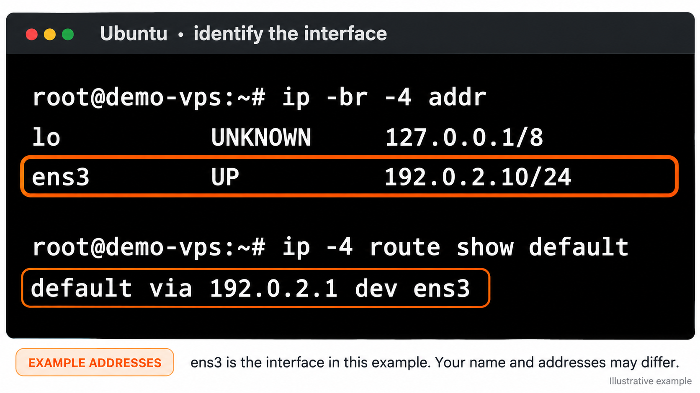
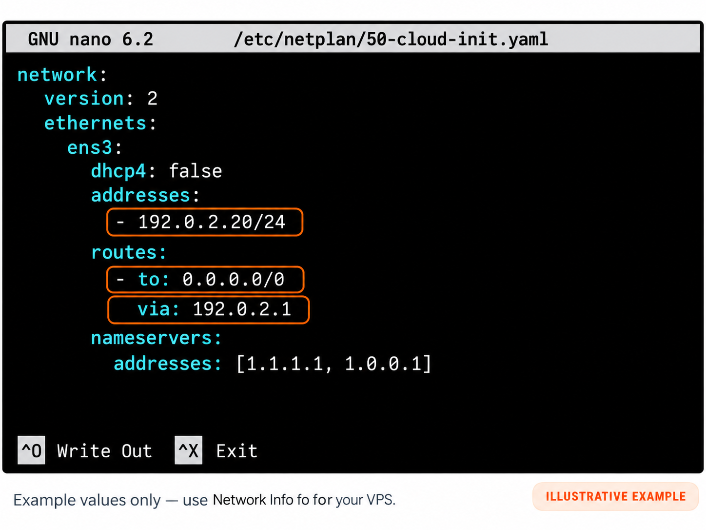

import { CtaButton } from "/snippets/cta-button.mdx";

## Инструкция по ручной смене IP {#manual-ip-change-instructions}

Узнайте, как изменить IP-адрес без переустановки сервера. Следуйте пошаговой инструкции по ручной настройке сети в Ubuntu.

<Warning>
  Используйте только IP-адрес, длину префикса, шлюз и DNS, назначенные вашему VPS в [Network Info](/ru/vps-management/ip-address-information). Адреса на снимках — примеры. Держите консоль VNC открытой: изменение IP прерывает SSH-подключения.
</Warning>

### Откройте панель и запустите VNC {#access-portal-and-launch-vnc}

<Steps>
  <Step title="Войдите в панель">
    [Панель управления VPS](https://manage.edisglobal.com/clientarea.php)
  </Step>
  <Step title="Включите VNC-сервер">
    Следуйте [инструкции по включению VNC](/ru/vps-management/enable-vnc-server).
  </Step>
  <Step title="Откройте VNC">
    Войдите с именем пользователя и паролем Ubuntu. Работайте непосредственно в консоли или откройте Terminal, если установлен графический рабочий стол.
  </Step>
</Steps>

---

### Определите сетевой интерфейс {#identify-your-network-interface}

Выполните в консоли VNC следующие команды чтения данных:

```bash
ip -br -4 addr
ip -4 route show default
```

Проверять нужно интерфейс после `dev` в маршруте по умолчанию. Он может называться `ens3`, `eth0` или иначе. Интерфейс обратной петли `lo` не является вашим публичным сетевым интерфейсом.

<Frame caption="Воссозданный пример с адресами для документации. Используйте имя интерфейса, показанное на вашем VPS.">
  
</Frame>

---

### Отредактируйте файл конфигурации Netplan {#edit-the-netplan-configuration-file}

**Перейдите в каталог Netplan**:

```bash
cd /etc/netplan/
```

Перед редактированием сохраните копию текущей конфигурации Netplan вне `/etc/netplan/`:

```bash
sudo cp -a /etc/netplan /root/netplan-before-ip-change
ls /etc/netplan/
```

**Откройте файл конфигурации**, например `50-cloud-init.yaml`:

```bash
sudo nano /etc/netplan/50-cloud-init.yaml
```

Примечание: имя файла в вашей системе может отличаться, например `01-network-manager-all.yaml`. Убедитесь, что редактируете правильный файл своей установки.

---

### Измените IP-адрес {#change-the-ip-address}

1. В существующей конфигурации интерфейса замените старый IPv4-адрес и префикс новыми значениями из **Network Info**.
2. Обновите шлюз IPv4, если он изменился. Сохраните существующие настройки IPv6, сопоставление интерфейса, renderer и особые маршруты, если новое назначение сети не требует их изменения.
3. Проверьте DNS. Адреса DNS-серверов ниже — примеры; оставьте серверы, подходящие вашему VPS.

<Frame caption="Воссозданный пример Netplan. 192.0.2.20/24 и 192.0.2.1 — адреса для документации, а не настройки для копирования.">
  
</Frame>

Упрощённый пример выше доступен для копирования:

```yaml
network:
  version: 2
  ethernets:
    ens3:
      dhcp4: false
      addresses:
        - 192.0.2.20/24
      routes:
        - to: 0.0.0.0/0
          via: 192.0.2.1
      nameservers:
        addresses: [1.1.1.1, 1.0.0.1]
```

<Note>
  Измените нужные значения в существующем файле; не заменяйте более полную конфигурацию этим упрощённым примером. `/24` — только пример префикса. Старые файлы Netplan могут использовать `gateway4` вместо маршрута по умолчанию; обновляйте существующий параметр шлюза, не добавляя дубликат. См. [справочник конфигурации Netplan](https://netplan.readthedocs.io/en/stable/netplan-yaml/).
</Note>

---

### Настройте несколько IP (необязательно) {#configure-multiple-ips-optional}

Добавляйте только адреса, назначенные этому VPS компанией EDIS Global. Перечислите каждый адрес в ключе `addresses` того же интерфейса, сохранив существующие записи IPv6:

```yaml
addresses:
  - 192.0.2.20/24
  - 192.0.2.21/24
  - 192.0.2.22/24
```

Это примеры для документации. Используйте свои назначенные адреса и длины префикса и соблюдайте отступы окружающего файла. Отдельная инструкция — [Настройка дополнительных IP-адресов](/ru/faq/ip-addresses/configuring-additional-ip-address-linux).

---

### Сохраните конфигурацию {#save-configuration}

1. Нажмите `Ctrl + O`, чтобы записать файл.
2. Нажмите `Enter`, чтобы подтвердить имя файла.
3. Нажмите `Ctrl + X`, чтобы выйти.

---

### Примените сетевые изменения {#apply-network-changes}

Сначала проверьте YAML, затем опробуйте конфигурацию с ограниченным временем подтверждения:

```bash
sudo netplan generate
sudo netplan try --timeout 120
```

Если проверка сообщает об ошибке, исправьте её перед продолжением. Во время пробного применения проверьте доступность нового IP со своего компьютера, а шлюз и DNS — с VPS. Подтверждайте в консоли VNC только после проверки работоспособности.

Если не подтвердить изменения, Netplan попытается выполнить откат. Держите VNC доступным и перед перезагрузкой проверьте как работающую сеть, так и файлы на диске: откат имеет документированные ограничения. См. [справку по `try` в Netplan](https://netplan.readthedocs.io/en/stable/netplan-try/).

---

### Проверьте конфигурацию {#verify-configuration}

Проверьте новые IP-настройки следующей командой:

```bash
ip a
```

Или проверьте конкретный интерфейс:

```bash
ip addr show dev ens3
```

(Замените `ens3` фактическим именем своего сетевого интерфейса.)

---

#### Быстрый Ubuntu VPS: готов за несколько минут {#fast-ubuntu-vps-ready-in-minutes}

Запустите защищённый **Ubuntu VPS** с числом ядер vCPU до 8. Мгновенная настройка, полный доступ root, диски SSD/NVMe и надёжная производительность по всему миру.

Выберите локацию и тариф VPS, укажите Ubuntu 24.04, 22.04 или 20.04 LTS при заказе и начните работу с полным SSH-доступом за несколько минут.

<CtaButton label="Запустить Ubuntu VPS" link="https://www.edisglobal.com/vps-hosting/ubuntu-vps" />
