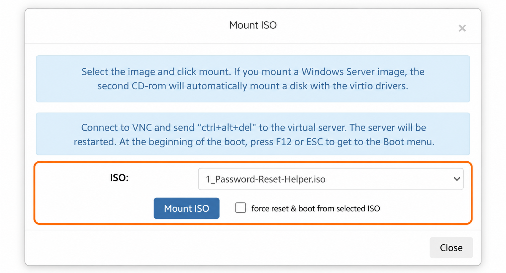

## Подключение ISO-образа к VPS {#mount-an-iso-image-on-your-vps}

1. Откройте [панель управления VPS](https://manage.edisglobal.com/clientarea.php), затем **Services → My Services**.
2. Выберите VPS и откройте **Server Information → Mount ISO**.
3. Выберите образ из выпадающего списка. Можно использовать готовый образ или ISO, который вы [загрузили самостоятельно](/ru/vps-management/bring-your-own-iso).
4. Решите, нужно ли только подключить образ или сразу перезапустить VPS с него, затем нажмите **Mount ISO**.

<Frame caption="Пример: выбран образ Password Reset Helper; принудительный перезапуск не включён.">
  
</Frame>

### Только подключить или сразу загрузить? {#attach-only-or-boot-immediately}

- Оставьте **force reset & boot from the selected ISO** неотмеченным, чтобы подключить образ без немедленного перезапуска.
- Отметьте его, когда готовы перезапустить VPS и загрузить ISO. Это прервёт работу ОС и её подключения; сначала сохраните работу.

Откройте [VNC / Open Console](/ru/vps-management/enable-vnc-server), чтобы наблюдать загрузку и работать с установщиком или средой восстановления. Если вы подключили образ без перезапуска, перезапустите сервер, когда будете готовы, и выберите виртуальный CD-ROM в загрузочном меню.

Само подключение ISO не переустанавливает VPS. Следуйте инструкциям выбранного образа и отключите его по завершении, чтобы VPS мог загрузиться со своего обычного диска.
