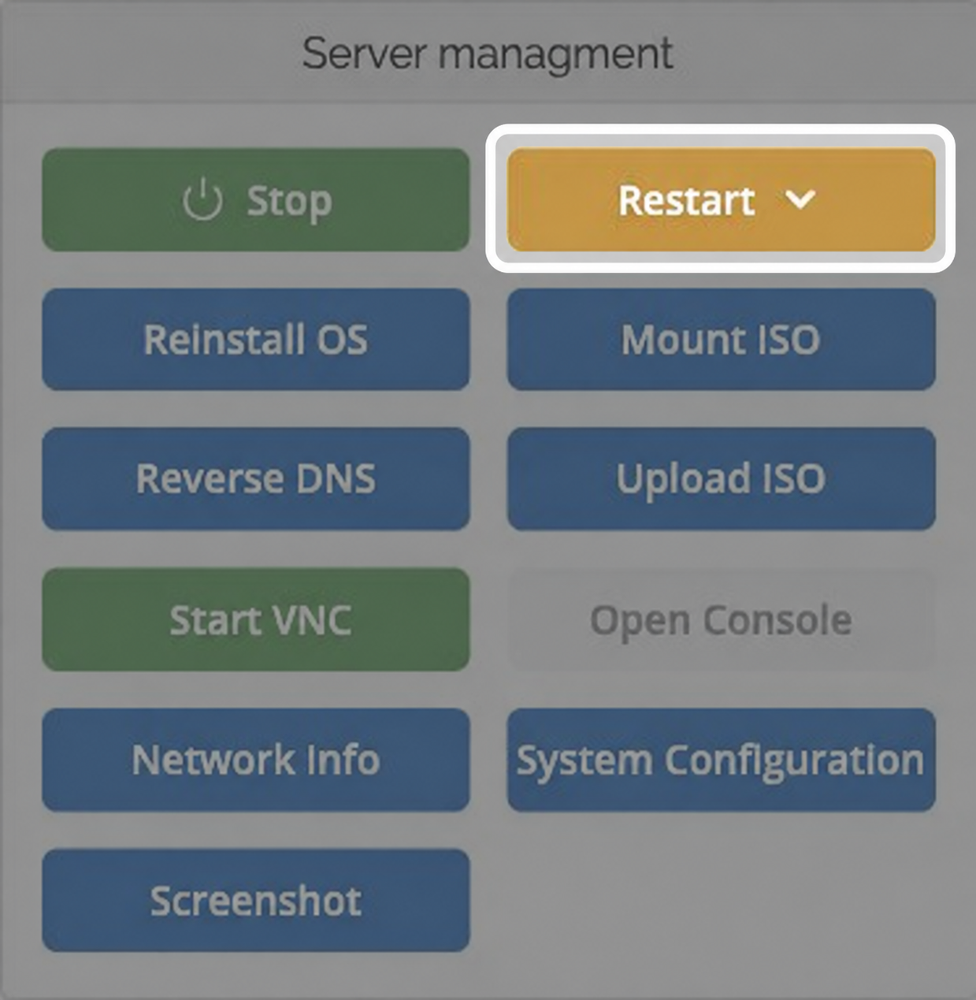
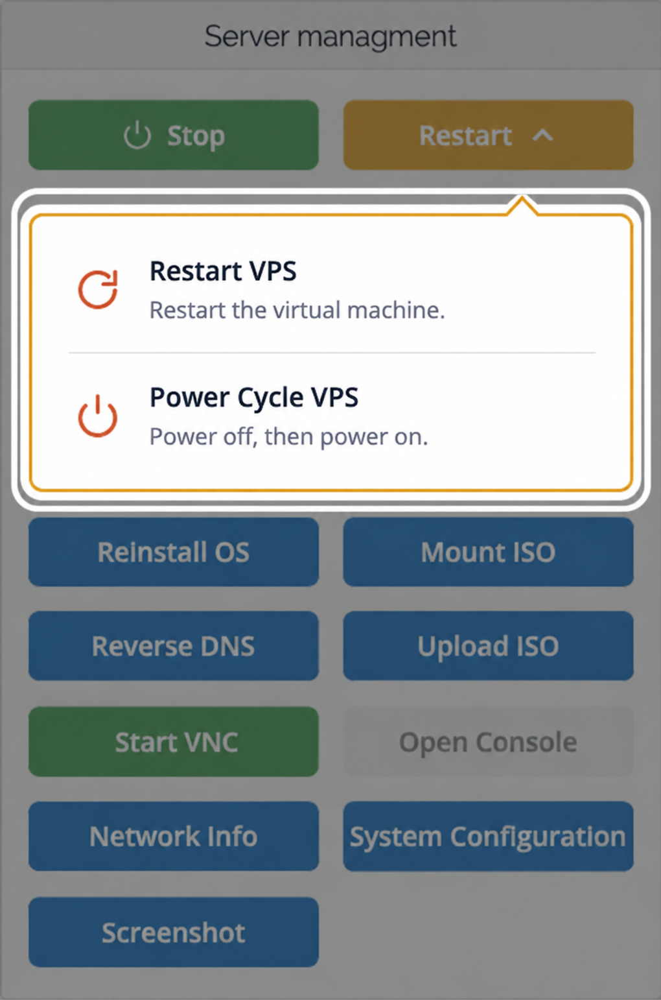

<span id="restart-reset-or-power-cycle-your-vps"></span>

## Какой вариант выбрать? {#which-option-should-i-use}

| Ситуация | Что сделать |
| --- | --- |
| Linux или Windows отвечает, нужна обычная перезагрузка. | **Перезагрузите сервер из операционной системы.** Это позволит ей закрыть приложения и завершить ожидающие записи на диск. |
| Нужно перезагрузить сервер из панели. | Сначала выберите **Restart → Restart VPS**. |
| Restart VPS не помог или VPS завис. | Выберите **Restart → Power Cycle VPS**, чтобы выключить и снова включить его. |
| VPS уже остановлен. | Нажмите **Start**. |

<Warning>
  Оба варианта перезапуска в панели прерывают работу VPS и его служб. Они не заменяют корректную перезагрузку из Linux или Windows: несохранённая работа и незавершённые записи на диск могут быть потеряны. Если ОС отвечает, используйте её функцию перезагрузки.
</Warning>

## Найдите меню Restart {#find-the-restart-menu}

1. Войдите в [панель управления VPS](https://manage.edisglobal.com/clientarea.php).
2. Откройте **Services → My Services** и выберите VPS.
3. На вкладке **Server Information** найдите блок управления сервером.
4. Нажмите жёлтую кнопку **Restart**, чтобы открыть меню.

<Frame caption="Жёлтая кнопка Restart открывает варианты перезапуска.">
  
</Frame>

Меню содержит **Restart VPS** и **Power Cycle VPS**. Открытие меню не перезапускает сервер: необходимо выбрать действие.

<Frame caption="Сначала выберите Restart VPS. Используйте Power Cycle VPS, если перезагрузка не устранила проблему.">
  
</Frame>

## Restart VPS {#restart-vps}

Выберите **Restart → Restart VPS**, чтобы сбросить виртуальную машину без полного выключения и повторного включения.

ОС перезагрузится, но процесс виртуальной машины и её VNC-сервер продолжат работать. Если VNC уже включён, можно наблюдать загрузку в консоли.

1. Чтобы следить за перезагрузкой, нажмите **Start VNC**, если VNC отключён, затем **Open Console**. См. [руководство по VNC](/ru/vps-management/enable-vnc-server).
2. Откройте **Restart** и выберите **Restart VPS**.
3. Дождитесь загрузки ОС и снова подключитесь по SSH или через удалённый рабочий стол.

<Note>
  Доступность VNC **не** сохраняет подключения приложений, SSH или удалённого рабочего стола. Эти службы прерываются на время перезапуска ОС. В старых инструкциях действие может называться **Reset VPS**; в текущей панели оно называется **Restart VPS**.
</Note>

## Power Cycle VPS {#power-cycle-vps}

Если **Restart VPS** не устраняет проблему, выберите **Restart → Power Cycle VPS**.

Это выключит и снова включит виртуальную машину, запустив новый процесс. Также остановится текущий VNC-сервер. Если вы использовали VNC, после полного перезапуска снова нажмите **Start VNC** и откройте **Open Console**.

Дождитесь запуска ОС и служб перед повторным подключением. Если VPS всё ещё не отвечает, [обратитесь в поддержку](/ru/getting-started/how-our-support-team-helps-you), указав ID VPS или IP-адрес, время возникновения проблемы и то, что видно в консоли.

## Корректная перезагрузка из Linux или Windows {#restart-gracefully-from-linux-or-windows}

При плановом обслуживании сохраните работу и перезагрузите сервер из операционной системы.

### Linux {#linux}

Подключитесь по SSH или через консоль и выполните:

```bash
sudo shutdown -r now
```

Если вы вошли как root, опустите `sudo`. SSH отключится во время перезагрузки; подключитесь снова после запуска сервера.

### Windows {#windows}

В Windows выберите **Start → Power → Restart**. Сеанс удалённого рабочего стола отключится во время перезагрузки; подключитесь снова, когда Windows и удалённый рабочий стол будут готовы.

## Запуск и остановка VPS {#start-or-stop-a-vps}

- **Start** включает остановленный VPS.
- **Stop** выключает VPS и оставляет его выключенным. Если Linux или Windows отвечает, сначала завершите работу из самой ОС. Используйте `sudo shutdown -h now` в Linux или **Start → Power → Shut down** в Windows.

Перезапуск не переустанавливает ОС. [Reinstall OS](/ru/vps-management/autoinstall-reinstall-install-vps-linux-windows) — отдельное действие, которое перезаписывает существующую систему и данные. Храните [резервные копии](/ru/getting-started/backups) вне VPS.

Остановка VPS не отменяет услугу. Чтобы прекратить услугу, запросите отмену в личном кабинете.
