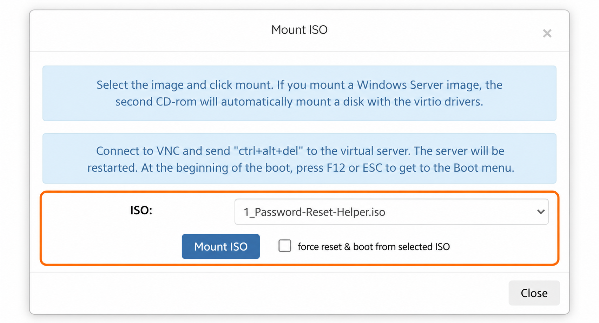
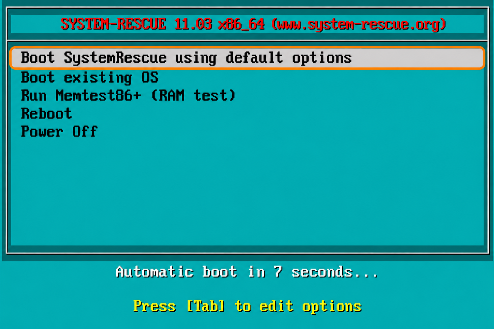
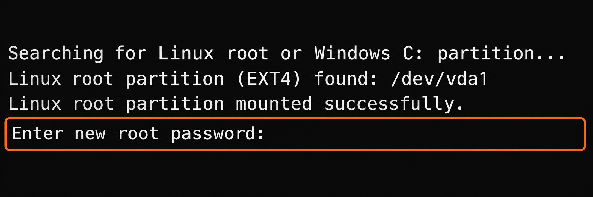
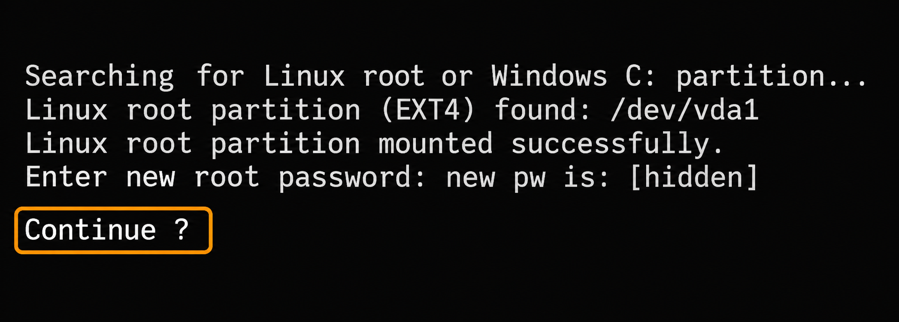
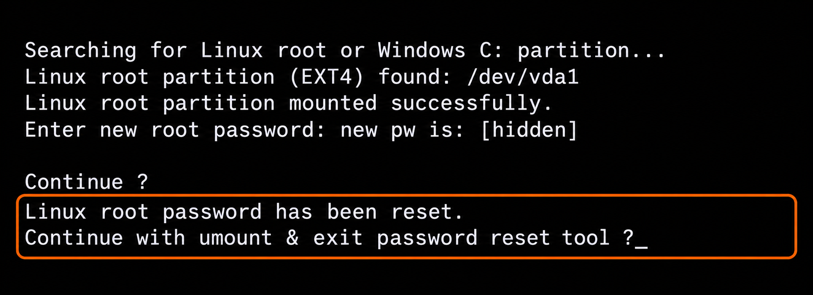
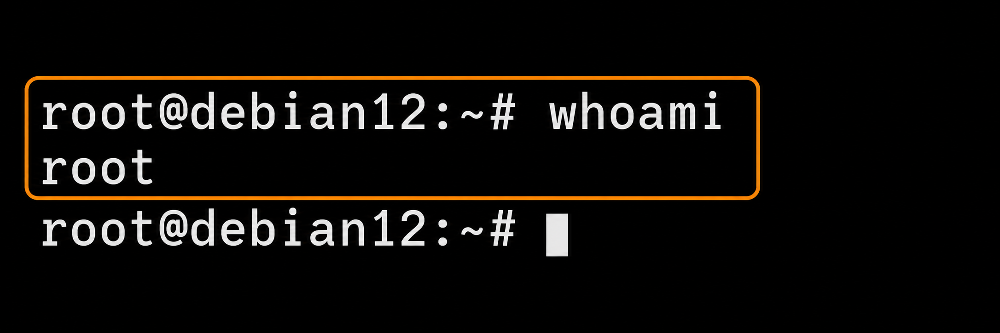

Это руководство показывает, как сбросить пароль root на Linux VPS без переустановки ОС и риска потери данных. Для восстановления доступа сервер загружается со специально подготовленного образа сброса пароля. EDIS предоставляет неизменённые образы ОС без предустановленных гостевых драйверов KVM, поэтому сменить пароль из панели администратора невозможно. Следуйте приведённым шагам, чтобы безопасно задать новый пароль root на Linux VPS с KVM. Метод работает с различными дистрибутивами, включая Ubuntu, Debian, CentOS, Rocky Linux, AlmaLinux и даже Arch Linux.

### Откройте панель управления VPS {#access-the-vps-management-portal}

* Войдите в [панель управления VPS](https://manage.edisglobal.com/clientarea.php).
* Найдите VPS в **Services → My Services**.

### Подключите образ сброса пароля и загрузитесь с него {#mount-password-reset-helper-image-and-boot}

* [**Включите VNC-сервер**](/ru/vps-management/enable-vnc-server).
* Нажмите [Mount ISO](/ru/vps-management/mount-iso-image).
* В выпадающем списке выберите образ **1_Password-Reset-Helper.iso** 💿.
* Установите флажок ✅ **force reset & boot from the selected ISO** и нажмите **Mount ISO**.

  

  _На снимке показан выбор образа до включения принудительного перезапуска._

* Откройте noVNC или подключитесь через VNC-клиент (RealVNC Viewer, TightVNC Viewer, UltraVNC).

### Откройте консоль в браузере {#open-the-browser-console}

1. Нажмите **Open Console**, чтобы увидеть вывод консоли.
2. Щёлкните внутри окна noVNC в браузере, чтобы передать ему фокус.
3. Дождитесь автоматической загрузки ISO:

   

4. После успешной загрузки ISO помощник предложит изменить пароль:

   

5. Введите новый надёжный пароль и нажмите **Enter** ⌨️.
6. Помощник покажет новый пароль и **Continue ?**. Проверьте пароль и нажмите **Enter** для продолжения. На снимке ниже пароль скрыт; в самом помощнике он отображается.

   

7. Когда появится **Linux root password has been reset.**, нажмите **Enter** в запросе на отключение образа и выход:

   

8. VPS автоматически перезагрузится. После загрузки ОС войдите как **root** с новым паролем. Выполните `whoami`, чтобы убедиться, что сеанс использует учётную запись root:

   

### Отключите ISO {#unmount-the-iso}

После сброса пароля [отключите ISO](/ru/vps-management/mount-iso-image) **Password Reset Helper** в панели управления VPS.

### Отключите доступ VNC {#disable-vnc-access}

Закройте вкладку **noVNC** и [отключите доступ VNC](/ru/vps-management/enable-vnc-server) в панели управления VPS.

### Учётные данные успешно обновлены! 🐧 {#credentials-updated-successfully-}

Вы успешно сбросили пароль root в Linux с помощью предоставленного образа восстановления. VPS использует обновлённые учётные данные, и административный доступ восстановлен. Теперь можно продолжить обслуживание или настройку.
