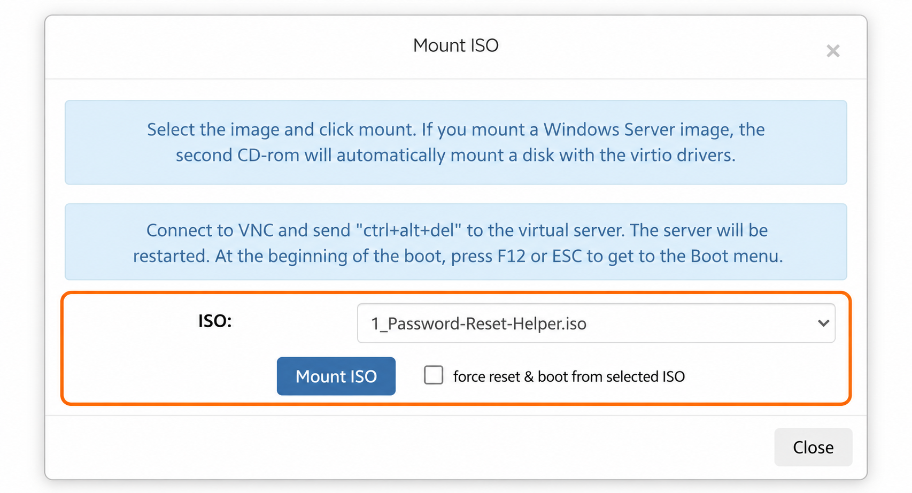
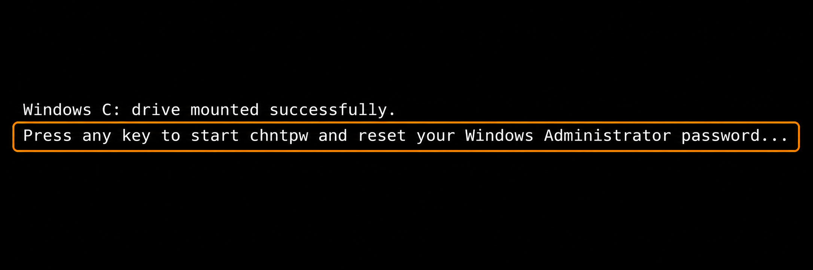
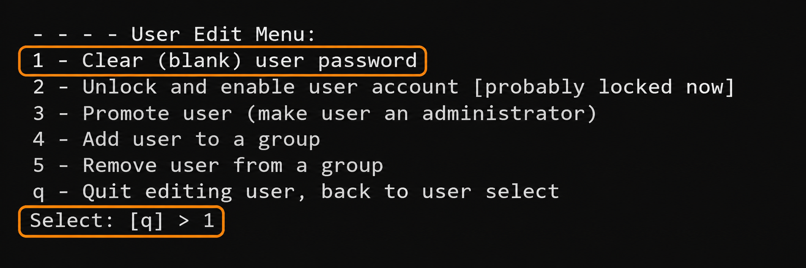
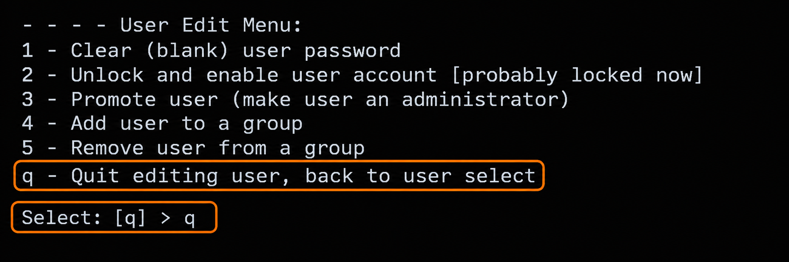
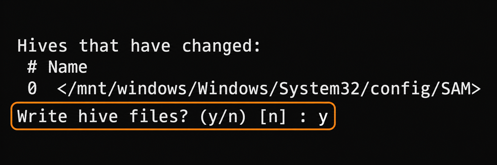
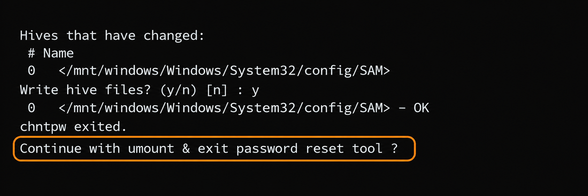
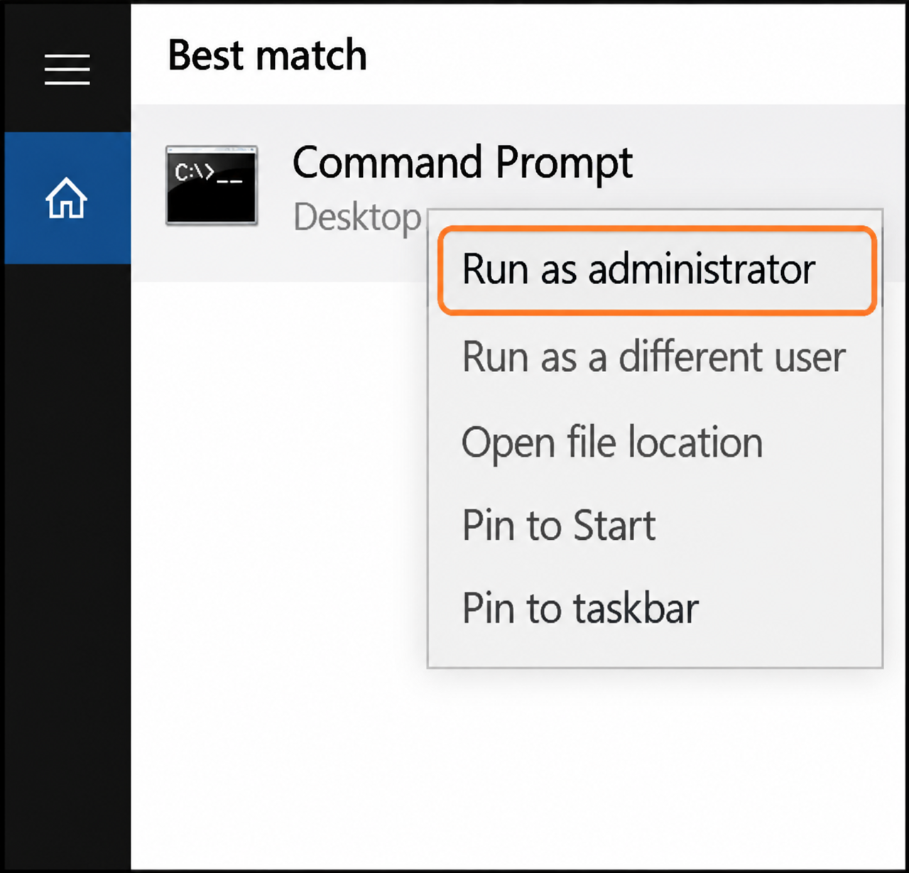
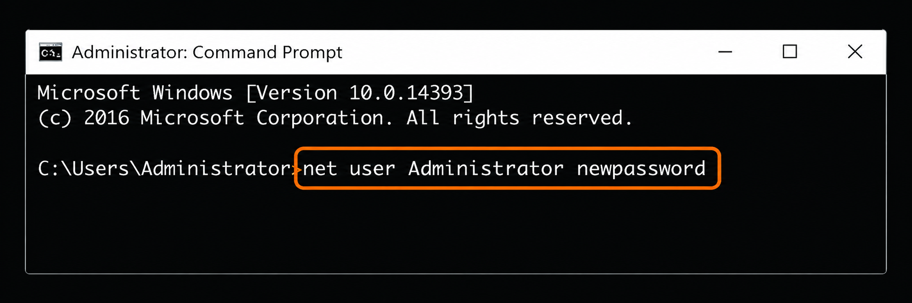

Это руководство описывает распространённый способ восстановления доступа к Windows Server, если вы забыли или потеряли пароль учётной записи администратора. Процедура изменяет локальную учётную запись Windows без переустановки операционной системы.

<Warning>
  Сброс пароля вне работающей ОС может сделать файлы, зашифрованные EFS, недоступными. Этот метод не разблокирует BitLocker и не сбрасывает учётную запись домена Active Directory. Если используется шифрование, перед продолжением проверьте ключи и способ восстановления. См. [FAQ инструмента сброса пароля](https://mail.pogostick.net/~pnh/ntpasswd/faq.html).
</Warning>

### Откройте панель управления VPS {#access-the-vps-management-portal}

* Войдите в [панель управления VPS](https://manage.edisglobal.com/clientarea.php).
* Найдите VPS в **Services → My Services**.

### Подключите образ сброса пароля и загрузитесь с него {#mount-password-reset-helper-image-and-boot}

* [**Включите VNC-сервер**](/ru/vps-management/enable-vnc-server).
* Нажмите [Mount ISO](/ru/vps-management/mount-iso-image).
* В выпадающем списке выберите образ **1_Password-Reset-Helper.iso**.
* Установите флажок **force reset & boot from the selected ISO** и нажмите **Mount ISO**.

  

  _На снимке показан выбор образа до включения принудительного перезапуска._

* Откройте noVNC или подключитесь через VNC-клиент.

### Откройте консоль в браузере {#open-the-browser-console}

1. Нажмите **Open Console**, чтобы увидеть вывод консоли.
2. Щёлкните внутри окна noVNC в браузере, чтобы передать ему фокус.
3. ISO загрузится автоматически. После загрузки появится уведомление:

   

4. Нажмите **Enter**, чтобы запустить **chntpw**.
5. В запросе **Select: [q] >** введите **1** и нажмите **Enter**, чтобы выбрать **Clear (blank) user password**:

   

6. После очистки пароля введите **q** и нажмите **Enter**, чтобы выйти из редактирования пользователя:

   

7. В запросе **Write hive files? (y/n) [n] :** введите **y** и нажмите **Enter**, чтобы сохранить изменение:

   

8. Убедитесь, что появились **OK** и **chntpw exited.**, затем нажмите **Enter** в запросе **Continue with umount & exit password reset tool ?**:

   

### Отключите ISO {#unmount-the-iso}

После сброса пароля [отключите ISO](/ru/vps-management/mount-iso-image) **Password Reset Helper** в панели управления VPS.

### Перезагрузите и проверьте {#reboot-and-test}

После перезагрузки войдите через **консоль VNC** в локальную учётную запись Administrator, пароль которой вы очистили. В зависимости от настроек Windows может потребоваться выбрать её на экране входа. **Сразу задайте надёжный пароль, прежде чем пробовать RDP.** Откройте командную строку (CMD) с правами администратора:



В командной строке с повышенными правами замените `newpassword` своим надёжным паролем перед выполнением:

```shell
net user Administrator newpassword
```

`Administrator` — изменяемая учётная запись. **`newpassword` — только пример-заполнитель. Не используйте его как настоящий пароль.** На снимке показана команда до выполнения.



<Tip>
  Чтобы не указывать новый пароль в командной строке, выполните `net user Administrator *` и введите его в скрытых запросах. Этот вариант описан Microsoft в [справочнике net user](https://learn.microsoft.com/en-us/windows-server/administration/windows-commands/net-user).
</Tip>

### Отключите доступ VNC {#disable-vnc-access}

Закройте вкладку **noVNC** и [отключите доступ VNC](/ru/vps-management/enable-vnc-server) в панели управления VPS.

### 🎉 Поздравляем! {#-congratulations}

Вы успешно обновили пароль Administrator в Windows. Войдите на сервер с новыми учётными данными: это подтвердит, что смена пароля вступила в силу и доступ восстановлен. Удачной работы! :)
