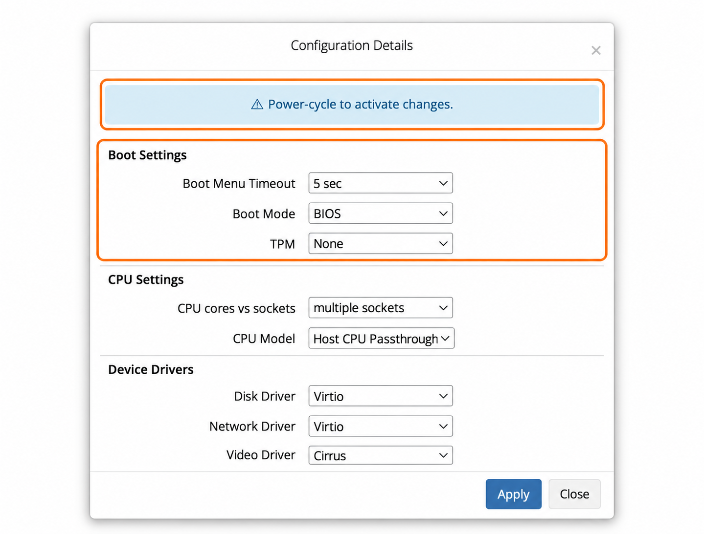

## ⚙️ Окно System Configuration в панели управления VPS {#-system-configuration-dialog-in-the-vps-management-portal}

Окно **System Configuration** в панели VPS позволяет менять важные параметры эмуляции оборудования. Эти настройки помогают оптимизировать производительность и обеспечить совместимость с вашей ОС и рабочими задачами.

### Откройте окно {#open-the-dialog}

В [панели управления VPS](https://manage.edisglobal.com/clientarea.php) перейдите в **Services → My Services**, выберите VPS и откройте **Server Information → System Configuration**.

<Frame caption="Пример выбранных параметров, а не рекомендуемые настройки для любой ОС.">
  
</Frame>

Проверьте изменения и нажмите **Apply**. Следуйте указанию окна: **полностью выключите и снова включите VPS**, чтобы новые настройки виртуального оборудования вступили в силу. См. [руководство по полному перезапуску](/ru/vps-management/power-cycle-or-reboot-a-vps).

Ниже подробно описан каждый параметр:

---

## ⏲️ Время ожидания загрузочного меню {#-boot-menu-timeout}

Параметр определяет, как долго отображается загрузочное меню при запуске VPS.\
Варианты:

- **0 sec** — пропустить загрузочное меню.
- **5 sec (рекомендуется)** — небольшая пауза для доступа к параметрам загрузки при необходимости.
- **30 sec** — больше времени для выбора варианта загрузки.
- **60 sec** — увеличенное время для диагностики или ручного выбора.

Для большинства пользователей подходят **5 секунд**.

---

## 🆕 Режим загрузки и TPM {#-boot-mode-and-tpm}

System Configuration позволяет управлять:

- **Boot Mode:** BIOS или UEFI
- **TPM:** Disabled или Software TPM (vTPM)

### Поведение по умолчанию {#default-behavior}

- Для максимальной совместимости по умолчанию используются **BIOS** и **отключённый TPM**.

### Важно {#important}

- Установленный образ и загрузчик должны поддерживать выбранный режим BIOS или UEFI.
- Некоторые современные системы, например Windows 11, **требуют UEFI \+ TPM**.

### Как применяются настройки {#how-settings-are-applied}

- **Автоматические установщики** сами выбирают правильную конфигурацию.
- Ручные настройки в основном нужны при:
  - использовании **собственных образов**;
  - загрузке с **ISO**.

👉 Подробное руководство:\
[**UEFI, BIOS и vTPM: объяснение**](/ru/vps-management/uefi-vs-bios-and-v-tpm)

---

## 🧠 Ядра и сокеты CPU {#-cpu-cores-vs-sockets}

Параметр определяет представление процессорных ресурсов внутри VPS и действует только при наличии более одного vCPU.

- **Multiple Sockets**: эмулирует несколько физических процессоров. Полезно для некоторых старых систем, но может создавать дополнительные накладные расходы.
- **Multiple Cores**: эмулирует несколько ядер в одном процессорном сокете. Более эффективно и рекомендуется для большинства современных систем.

📖 [Подробнее о ядрах и сокетах CPU](/ru/faq/upgrades-downgrades/cpu-cores-vs-cpu-sockets-in-vps-environments/understanding-cpu-cores-vs-sockets-in-vps).

---

## 🧩 Модель CPU {#-cpu-model}

Определяет, как CPU представлен гостевой операционной системе:

- **default** — универсальная модель CPU с высокой совместимостью, подходящая большинству ОС.
- **Host CPU Passthrough** — передаёт VPS реальные возможности процессора хоста, например AES, SSE3, SSE4.1, SSE4.2, для повышения производительности. Особенно полезно задачам, использующим расширенные наборы инструкций.

**Рекомендация:**\
Для максимальной производительности и совместимости используйте **Host CPU Passthrough**, если у вашей ОС нет особых требований.

---

## 🖥️ Видеодрайвер {#-video-driver}

Определяет виртуальный видеоадаптер удалённой консоли VNC:

- **Cirrus**: стандартный вариант, совместимый с большинством ОС.
- **QXL**: улучшенная графическая производительность; в основном используется системами с поддержкой SPICE.

Для большинства пользователей достаточно **Cirrus**. Windows может работать немного быстрее с **QXL**.

---

## 💾 Драйвер диска {#-disk-driver}

Определяет, как накопитель VPS представлен гостевой ОС:

- **Virtio (рекомендуется)**: высокопроизводительный паравиртуальный драйвер. Требует драйверов Virtio: Linux поддерживает его встроенными средствами, Windows может потребовать установку драйверов.
- **IDE**: высокая совместимость, но более низкая производительность.
- **SCSI**: сбалансированный вариант для некоторых ОС.

> **Для Mikrotik RouterOS**:\
> Задайте **Disk Driver → IDE** для совместимости.\
> 📖 [Руководство по установке Mikrotik CHR](/ru/advanced-setup-guides/script-based-mikrotik-router-os-installation-guide-winbox)

---

## 🌐 Сетевой драйвер {#-network-driver}

Определяет эмулируемый сетевой интерфейс:

- **Virtio (рекомендуется)**: высокая производительность, но нужны драйверы.
- **E1000**: эмулирует сетевой адаптер Intel; совместим с большинством систем.
- **RTL8139**: устаревший вариант с широкой совместимостью, но меньшей производительностью.

> **Для Mikrotik RouterOS**:\
> Задайте **Network Driver → E1000** для наилучшей совместимости.\
> 📖 [Руководство по установке Mikrotik CHR](/ru/advanced-setup-guides/script-based-mikrotik-router-os-installation-guide-winbox)

---

## 🌍 Раскладка клавиатуры VNC {#-vnc-keymap}

VNC Keymap обеспечивает соответствие раскладки удалённого сеанса VNC вашей физической клавиатуре. Распространённые варианты:

- **en-us** — английская (США)
- **de** — немецкая
- **fr** — французская

Выберите раскладку своей локальной клавиатуры.

📖 [Подробнее о VNC](/ru/vps-management/enable-vnc-server#open-the-vps-console).

---

## 📝 Описание {#-description}

Чтобы изменить описание, нажмите карандаш рядом с **Description** в блоке **Information** услуги. Можно присвоить VPS собственное имя или заметку: это помогает организовать и различать серверы в личном кабинете.

Пример: pro-webserver-ffm

---

## 🔒 Настройки VLAN {#-vlan-settings}

Если вы приобрели опцию **Private VLAN**, этот список позволяет назначить VPS частной VLAN. Она обеспечивает защищённую изолированную сеть между вашими VPS на одном хосте.

В списке отображаются ID VLAN, доступные вашему аккаунту.

📖 [Подробнее об опции Private VLAN](/ru/faq/upgrades-downgrades/private-vlan-option)

---

## ⚠️ Важные замечания {#-important-notes}

- Для применения любого из этих параметров требуется **полное выключение и повторное включение** VPS.
- Используйте рекомендуемые драйверы для наилучшей производительности, если не требуется особая совместимость, например с Mikrotik.
