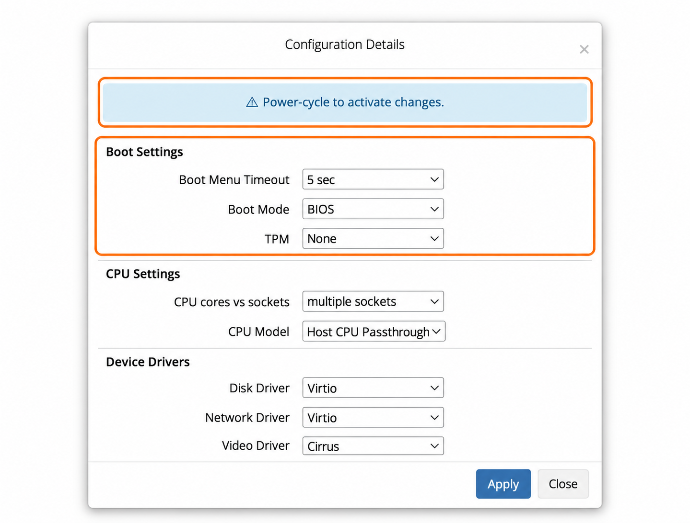

## 🆕 Обзор UEFI, BIOS и vTPM {#-uefi-bios-&amp;-vtpm-overview}

VPS EDIS Global поддерживают **BIOS (традиционная загрузка)**, **UEFI (современная загрузка)** и **vTPM (программный Trusted Platform Module)**.

Эти параметры прежде всего важны для **совместимости операционных систем**, особенно современных, например Windows 11.

---

## Где найти режим загрузки и настройки TPM {#find-boot-mode-and-tpm-settings}

Откройте VPS в **Services → My Services**, затем **Server Information → System Configuration**. Параметры находятся в **Boot Settings**. После ручного изменения выполните необходимые [инструкции по полному перезапуску](/ru/vps-management/power-cycle-or-reboot-a-vps).

<Frame caption="Пример выбранных параметров; выбирайте настройки, подходящие установленной ОС.">
  
</Frame>

## 🧭 BIOS и UEFI {#-bios-vs-uefi}

### 🟢 BIOS (по умолчанию) {#-bios-default}

- Традиционный режим загрузки
- Максимальная совместимость
- Подходит для образов ОС, установленных для загрузки через BIOS
- Рекомендуется для большинства установок Linux

Правильный параметр зависит от установленной ОС и способа развёртывания. Автоматические установщики могут выбрать другой режим загрузки.

---

### 🔵 UEFI {#-uefi}

- Современный стандарт загрузки
- Требуется более новым ОС
- Поддерживает расширенные функции, например Secure Boot

Windows 11 требует UEFI с возможностью Secure Boot и TPM 2.0; см. [требования Microsoft к Windows 11](https://support.microsoft.com/en-US/Windows/Experience/Compatibility/windows-11-system-requirements).

В Windows Server 2025 UEFI и TPM указаны как требования для **определённых функций**, а не для каждой установки. Проверьте требования своего образа и функций безопасности в [руководстве Microsoft по оборудованию Windows Server](https://learn.microsoft.com/en-us/windows-server/get-started/hardware-requirements). Сам выбор UEFI не подтверждает, что Secure Boot включён.

---

## 🔐 Что такое vTPM? {#-what-is-vtpm}

vTPM (Virtual Trusted Platform Module) — **программная эмуляция чипа TPM**.

Он требуется для:

- Установки Windows 11
- Некоторых функций безопасности ОС: шифрования диска, защищённых цепочек загрузки

### Варианты {#options}

- **None (Default)** → TPM отключён
- **Software TPM** → TPM включён

👉 Включайте vTPM только если он нужен вашей ОС.

---

## ⚙️ Конфигурация по умолчанию {#-default-configuration}

Для максимальной совместимости:

- **Boot Mode:** BIOS
- **TPM:** Disabled

Эти значения подходят для большинства сценариев.

---

## 🤖 Поведение автоматического установщика {#-auto-installer-behavior}

При использовании **автоматических установщиков** EDIS Global они:

- **Автоматически выбирают** BIOS или UEFI
- **Включают или отключают** TPM по необходимости

👉 Автоматические установщики **игнорируют** ручные настройки, чтобы обеспечить успешную установку.

---

## 🧩 Когда нужна ручная настройка {#-when-manual-configuration-matters}

Ручные настройки BIOS / UEFI / TPM важны в следующих случаях:

### ✔️ Собственные образы Cloud-Init {#-custom-cloud-init-images}

- Можно:
  - использовать текущие настройки VPS;
  - переопределить режим загрузки и TPM при развёртывании.

---

### ✔️ Собственные ISO и загруженные образы {#-custom-iso-/-uploaded-images}

- VPS использует **настройки System Configuration**.
- При необходимости:
  1. Измените Boot Mode / TPM.
  2. **Полностью выключите и снова включите VPS**.
  3. Загрузите свой образ.

---

## ⚠️ Что важно учитывать {#-important-considerations}

### Совместимость ОС {#os-compatibility}

- Образ должен содержать загрузчик, совместимый с выбранным режимом прошивки.
- Переключение BIOS → UEFI для существующей установки обычно приводит к:
  - ❌ Сбою загрузки

---

### Изменение режима загрузки {#changing-boot-mode}

- Режим загрузки должен соответствовать способу установки ОС.
- Для его последующего изменения требуются:
  - переустановка;
  - либо сложное ручное восстановление.

---

### Использование TPM {#tpm-usage}

- В большинстве случаев Linux не требует TPM.
- Включайте его только при явной необходимости.
- Если TPM не используется, он добавляет сложность без пользы.

---

## 🧾 Краткие рекомендации {#-quick-recommendations}

- Сохраняйте существующий режим загрузки установленной системы.
- Для нового собственного образа соблюдайте его требования к BIOS/UEFI и TPM. Образы Linux могут поддерживать любой из режимов.
- Для Windows 11 выберите UEFI и Software TPM; также проверьте остальные требования ОС.

---

## 🧭 Сводная таблица {#-summary}

| Параметр | По умолчанию | Когда менять |
| --- | --- | --- |
| Boot Mode | BIOS | Только если ОС требует UEFI |
| TPM | Disabled | Только если ОС требует TPM |

---

Если вы не уверены, какую конфигурацию использовать, **автоматический установщик всегда сам выберет правильные настройки**.
