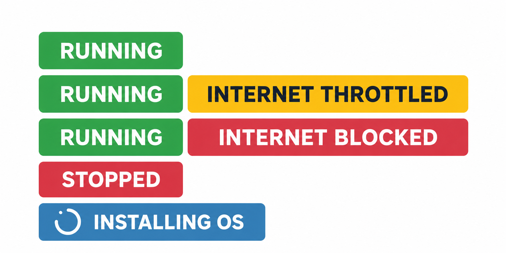

Индикаторы состояния в [панели управления VPS](https://manage.edisglobal.com/) показывают, работает ли VPS и ограничено ли его интернет-соединение.

Чтобы найти их, откройте **Services → My Services**, выберите VPS и найдите **Server Status** в блоке **Information** на вкладке **Server Information**.

<Frame caption="Индикаторы состояния VPS и примеры сочетаний состояния питания и интернет-соединения.">
  
</Frame>

## Кратко об индикаторах состояния {#status-badges-at-a-glance}

| Индикатор | Значение |
| --- | --- |
| **RUNNING** | VPS включён. Если рядом нет дополнительного предупреждения об интернете, соединение работает на обычной скорости. |
| **INTERNET THROTTLED** | Доступный объём трафика исчерпан. Скорость интернета ограничена до **1 Mbps**. |
| **INTERNET BLOCKED** | Мы временно отключили интернет после рассмотрения жалобы на нарушения. Доступ к VPS через **noVNC** сохраняется. |
| **STOPPED** | VPS выключен. |
| **INSTALLING OS** | Выполняется автоматическая установка операционной системы. |

## VPS работает {#running}

**RUNNING** означает, что VPS включён. Если этот индикатор отображается без дополнительных предупреждений, ограничение скорости из-за трафика и блокировка интернета из-за жалобы не применяются.

У работающего VPS также могут отображаться **INTERNET THROTTLED** или **INTERNET BLOCKED**. Эти дополнительные индикаторы описывают интернет-соединение; сам VPS продолжает работать.

Индикатор показывает состояние питания VPS. Он не проверяет работу отдельных приложений, сайтов, SSH или удалённого рабочего стола внутри ОС.

## Скорость интернета ограничена {#internet-throttled}

**INTERNET THROTTLED** означает, что доступный объём трафика исчерпан. VPS остаётся в сети, но скорость его интернет-соединения ограничена до **1 Mbps**.

Чтобы восстановить обычную скорость:

- **Назначьте дополнительный трафик из Traffic Pool** этому VPS. Если остатка в пуле недостаточно, сначала пополните его, затем назначьте трафик.
- **Дождитесь ежемесячного пополнения трафика.** В блоке **Traffic Information** VPS показана дата следующего пополнения или обратный отсчёт.

<Note>
  Покупка Pool Traffic добавляет трафик в общий пул. Чтобы увеличить доступный объём конкретного VPS, назначьте ему трафик вручную или через Auto-Hydration.
</Note>

Инструкции приведены в разделе [Traffic Pool и Auto-Hydration](/ru/faq/traffic-bandwidth/traffic-pool). Подробнее об объёме трафика и цикле пополнения — в разделе [Использование трафика и ежемесячные пополнения](/ru/faq/traffic-bandwidth/traffic-stats-refill-explained).

## Интернет заблокирован {#internet-blocked}

**INTERNET BLOCKED** означает, что мы временно отключили интернет-соединение VPS после рассмотрения жалобы на нарушения. Это помогает остановить активность, на которую поступила жалоба, и защитить нашу инфраструктуру и возможных пострадавших.

При блокировке мы отправляем письмо с подробностями, а также самой жалобой или подтверждающими материалами в тексте либо во вложении. Конкретная причина для вашего VPS указана в этом письме.

### Доступ к VPS через noVNC {#access-your-vps-through-novnc}

VPS продолжает работать, и **noVNC остаётся доступным при заблокированном интернете**. Используйте его для входа, проверки и внесения изменений.

Если VNC сейчас отключён, нажмите **Start VNC** в панели, дождитесь включения и нажмите **Open Console**.

[Как открыть консоль noVNC](/ru/vps-management/enable-vnc-server)

### Вариант 1: устранить проблему и запросить проверку {#option-1-resolve-the-issue-and-request-a-review}

Используйте noVNC, чтобы разобраться в ситуации, устранить причину или удалить материалы, нарушающие правила. Затем ответьте на уведомление о нарушении и объясните:

- Что вызвало указанную в жалобе активность, если это известно.
- Что вы изменили, чтобы остановить её и предотвратить повторение.

Наша команда рассмотрит ответ и восстановит интернет, когда проблема будет устранена или нарушающие правила материалы будут удалены.

<Info>
  Если завершить исправление без доступа к сети невозможно, объясните это в ответе.
</Info>

### Вариант 2: переустановить VPS {#option-2-reinstall-your-vps}

Чтобы начать с чистой системы, используйте **Reinstall OS** — автоматический установщик ОС в панели управления VPS.

**После успешной переустановки интернет восстанавливается автоматически**, без ожидания рассмотрения ответа нашей командой.

<Warning>
  **Переустановка удаляет существующую операционную систему и данные.** Сохраните всё необходимое перед продолжением.
</Warning>

Следуйте [инструкции по переустановке VPS](/ru/vps-management/autoinstall-reinstall-install-vps-linux-windows), затем защитите новую систему перед возобновлением её использования.

Мы будем благодарны за ответ на уведомление о нарушении даже при переустановке: так мы узнаем, как вы решили проблему. Для автоматического восстановления после успешной переустановки такой ответ не требуется.

### Считаете жалобу ошибочной? {#think-the-report-is-incorrect}

Ответьте на уведомление о нарушении и объясните ситуацию, чтобы наша команда могла её проверить.

Общие рекомендации приведены в разделе [Ответы на жалобы о нарушениях](/responding-to-abuse-complaints).

## VPS остановлен {#stopped}

**STOPPED** означает, что VPS выключен. Операционная система и приложения не работают.

Чтобы включить его, используйте средства управления питанием в панели VPS. См. [Запуск, остановка и перезапуск VPS](/ru/vps-management/power-cycle-or-reboot-a-vps).

## Устанавливается ОС {#installing-os}

**INSTALLING OS** означает, что автоматический установщик настраивает операционную систему. Дождитесь завершения установки перед подключением по SSH или через удалённый рабочий стол.

<Warning>
  Не выключайте и не перезагружайте VPS и не запускайте повторную переустановку, пока установка не завершена.
</Warning>

Ожидаемое время установки и сведения о подключении приведены в [инструкции по переустановке VPS](/ru/vps-management/autoinstall-reinstall-install-vps-linux-windows#installation-time-and-port-behavior).
