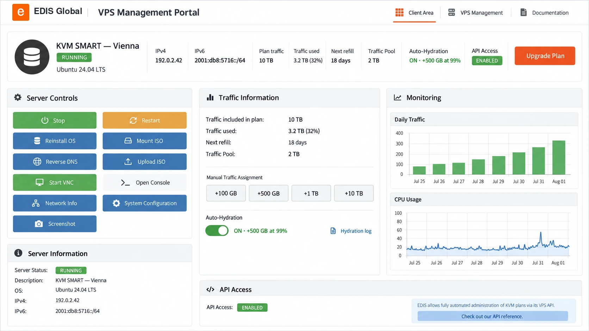
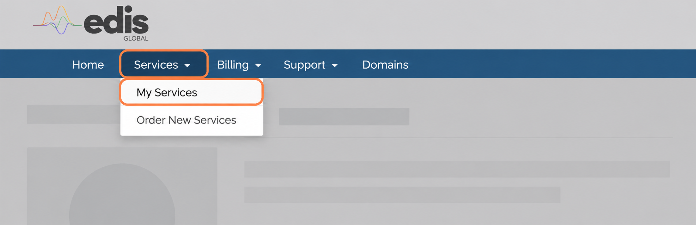

import { CtaButton } from "/snippets/cta-button.mdx";

## Полный контроль над VPS {#complete-control-of-your-vps}

Панель управления VPS EDIS Global позволяет управлять виртуальными серверами из одного удобного интерфейса. Меняйте IP-адрес, перезапускайте сервер, устанавливайте новую операционную систему, открывайте консоль, отслеживайте использование ресурсов, управляйте трафиком и автоматизируйте повседневные операции без ожидания помощи специалиста.

_В панели показаны вымышленные демонстрационные данные._

<CtaButton label="Открыть панель управления VPS" link="https://manage.edisglobal.com/clientarea.php" />

---

## Найдите свой VPS {#find-your-vps}

В главном меню выберите **Services → My Services**, затем VPS, которым хотите управлять. На вкладке **Server Information** находятся средства управления услугой, а на вкладке **Configurable Options** — увеличение ресурсов.

<Frame>
  
</Frame>

## Разберитесь со статусом VPS {#understand-your-vps-status}

Индикаторы **Server Status** показывают, работает ли VPS, а также ограничено ли его интернет-соединение по скорости или заблокировано. Объяснения и действия для восстановления обычного доступа приведены в разделе [Индикаторы состояния VPS](/ru/vps-management/understanding-vps-status).

## Управление сервером и его развёртывание {#control-and-deploy-your-server}

<Columns cols={2}>
  <Card title="Управление питанием" icon="power-off" href="/ru/vps-management/power-cycle-or-reboot-a-vps">
    Запускайте, останавливайте и перезапускайте VPS прямо из панели.
  </Card>

  <Card title="Установка ОС одним нажатием" icon="redo" href="/ru/vps-management/autoinstall-reinstall-install-vps-linux-windows">
    Устанавливайте и переустанавливайте поддерживаемые дистрибутивы Linux и редакции Windows с помощью автоматического установщика.
  </Card>

  <Card title="Собственные и готовые ISO" icon="compact-disc" href="/ru/vps-management/bring-your-own-iso">
    Подключите предоставленный образ или загрузите свой ISO для установки с индивидуальными настройками.
  </Card>

  <Card title="VNC и веб-консоль" icon="desktop" href="/ru/vps-management/enable-vnc-server">
    Подключайтесь к серверу через настольный VNC-клиент или консоль noVNC в браузере, даже если обычный сетевой доступ недоступен.
  </Card>

  <Card title="Поддержка Cloud-Init" icon="cloud" href="/ru/vps-management/edis-cloud-init-vps-installation">
    Автоматизируйте первоначальную настройку, создание пользователей, установку пакетов и повторяемое развёртывание с помощью пользовательских данных Cloud-Init.
  </Card>

  <Card title="Текущий снимок экрана" icon="camera">
    Посмотрите, что сейчас отображается на экране сервера, не открывая консоль и не запуская сеанс VNC.
  </Card>
</Columns>

---

## Управление IP-адресами и виртуальным оборудованием {#manage-ip-addresses-and-virtual-hardware}

Для VPN-провайдеров и других задач, зависящих от IP-адресов, панель предоставляет удобный доступ к основным настройкам IP и системы.

<Columns cols={2}>
  <Card title="Смена IP-адреса" icon="exchange-alt" href="/faq/ip-addresses/change-ip-address">
    Запросите новый основной IPv4-адрес в панели. Одна смена бесплатна в течение 24 часов после покупки; затем доступны варианты Standard и Bespoke.
  </Card>

  <Card title="Обратный DNS" icon="at" href="/faq/ip-addresses/setting-up-reverse-pointers">
    Настраивайте PTR-записи IPv4 и IPv6 для сервисов, которым необходим корректный обратный DNS.
  </Card>

  <Card title="Конфигурация системы" icon="sliders" href="/ru/vps-management/system-configuration-dialog">
    Меняйте параметры виртуального оборудования: дисплей, тайм-аут загрузки, эмуляцию сетевой карты и топологию CPU.
  </Card>

  <Card title="PIN-код поддержки" icon="key" href="/vps-management/your-support-pin">
    Найдите PIN-код конкретного сервера, который используется при обращениях в поддержку по вопросам, требующим проверки доступа к аккаунту.
  </Card>
</Columns>

---

## Мониторинг производительности и управление трафиком {#monitor-performance-and-manage-traffic}

Следите за работой VPS и заранее контролируйте лимиты трафика прямо в панели.

<Columns cols={2}>
  <Card title="Статистика использования" icon="chart-line" href="/faq/traffic-bandwidth/traffic-stats-refill-explained">
    Просматривайте графики CPU и трафика, объём трафика по тарифу, текущее потребление и дату следующего пополнения.
  </Card>

  <Card title="Глобальный Traffic Pool" icon="globe" href="/faq/traffic-bandwidth/traffic-pool">
    Проверяйте остаток в пуле, назначайте трафик вручную, настраивайте Auto-Hydration и просматривайте историю пополнений каждого VPS.
  </Card>
</Columns>

Каждый новый приобретённый VPS добавляет **100 GB бесплатного трафика** в общий Traffic Pool. Трафик в пуле не имеет срока действия и может быть назначен любому VPS в вашем аккаунте.

Для ручного назначения используйте кнопки **+100 GB**, **+500 GB**, **+1 TB** или **+10 TB** в панели. Для автоматической защиты настройте **Auto-Hydration** с шагом пополнения **100 GB**, **200 GB**, **300 GB** или **500 GB** для каждого VPS. Выбранный объём назначается при использовании 99% доступного трафика, если в пуле достаточно трафика.

<CtaButton label="Купить трафик для пула" link="https://www.edisglobal.com/buy-traffic" />

---

## Автоматизация инфраструктуры {#automate-your-infrastructure}

Используйте API EDIS Global, чтобы встроить развёртывание VPS и управление ими в собственную платформу, систему создания услуг или клиентский портал.

<Columns cols={2}>
  <Card title="Order API" icon="shopping-cart" href="/order-api-reference/order-api-welcome">
    Автоматизируйте настройку продукта, заказы, увеличение ресурсов и отмену услуг на протяжении всего жизненного цикла VPS.
  </Card>

  <Card title="Management API" icon="code" href="/management-api-reference/authentication/create-auth-session">
    Удалённо управляйте техническими функциями VPS и создавайте повторяемые процессы управления для большого числа серверов.
  </Card>
</Columns>

---

## Увеличение ресурсов, смена тарифа и управление оплатой {#upgrade-resources-plans-and-billing}

<Columns cols={2}>
  <Card title="Увеличить отдельные ресурсы" icon="sliders" href="/faq/upgrades-downgrades/upgrade-resources">
    Сохраните текущий тариф и добавьте до 24 GB RAM, 8 ядер vCPU, 400 GB диска с Drive Size Boost или 10 дополнительных IPv4-адресов. Стоимость рассчитывается пропорционально оставшейся части текущего расчётного периода.
  </Card>

  <Card title="Перейти на более мощный тариф" icon="arrow-up" href="/faq/upgrades-downgrades/upgrade-plan">
    Перейдите на более высокий тариф VPS прямо из панели. Вы оплачиваете только разницу в цене за оставшуюся часть текущего расчётного периода.
  </Card>

  <Card title="Продлить заранее или изменить период оплаты" icon="file-invoice" href="/ru/faq/billing-lifecycle/how-vps-renewals-work#renew-instantly-from-the-portal">
    Создайте счёт на продление до обычной даты оплаты и выберите подходящий период оплаты.
  </Card>
</Columns>

Откройте VPS в разделе **Services**, перейдите в **Configurable Options** и выберите **Upgrade Resources**. Будут показаны доступные для этого VPS дополнения:

| Ресурс | Максимальное дополнение |
| --- | ---: |
| RAM | +24 GB |
| vCPU | +8 ядер |
| Drive Size Boost | +400 GB |
| Дополнительные IPv4-адреса | 10 |

Drive Size Boost добавляется к дисковому пространству, уже включённому в тариф. После активации изменений диска, RAM или vCPU выполните предоставленные инструкции по полному выключению и повторному запуску. При увеличении диска также необходимо расширить раздел и файловую систему внутри гостевой ОС.

---

## Готовы начать? {#ready-to-get-started}

У вас уже есть VPS EDIS Global? Откройте панель и выберите услугу. Планируете новое развёртывание? Сравните тарифы VPS и выберите одну из 50 локаций по всему миру.

<CtaButton label="Открыть панель управления VPS" link="https://manage.edisglobal.com/clientarea.php" />

<CtaButton label="Посмотреть тарифы VPS" link="https://www.edisglobal.com/vps-hosting" />
