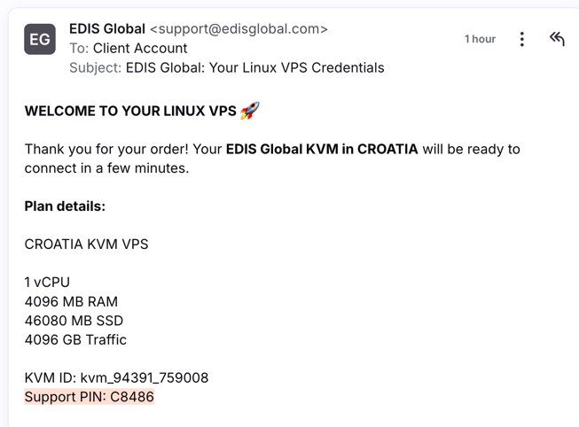
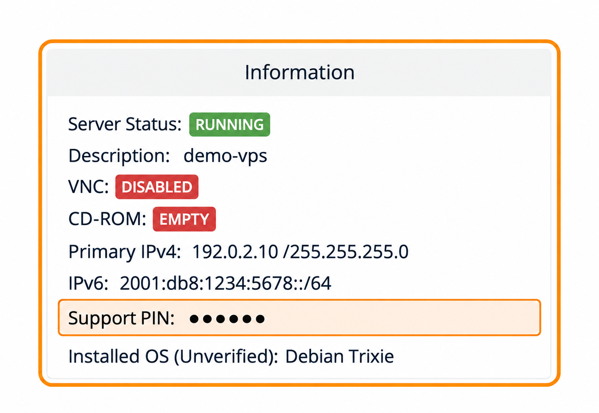

Support PIN помогает нам подтверждать принадлежность аккаунта при обработке важных запросов по VPS: индивидуальной переустановки, ручной смены IP или изменения аккаунта.

## Где найти PIN-код поддержки? {#where-can-you-find-your-support-pin}

Support PIN указан в письме с учётными данными VPS, которое отправляется сразу после заказа.

Найдите письмо с одной из следующих тем:

- **EDIS Global: Your Linux VPS Credentials**
- **EDIS Global: Your Windows VPS Credentials**

Support PIN находится в разделе **Plan details** письма, непосредственно под **KVM ID**.

<Frame>
  
</Frame>

## PIN-код поддержки в панели управления {#support-pin-in-the-control-panel}

Support PIN также можно найти прямо в панели управления VPS.

### Шаги {#steps}

1. Войдите в панель управления VPS.
2. Откройте **Services → My Services**.
3. Выберите VPS.
4. На вкладке **Server Information** найдите блок **Information**.

Найдите строку **Support PIN** под сведениями об IP-адресе.

<Frame caption="PIN-код и данные сервера обезличены.">
  
</Frame>

## Когда нужен PIN-код поддержки? {#when-do-you-need-the-support-pin}

Мы можем попросить Support PIN при:

- Обращении в поддержку по поводу VPS
- Запросе важных изменений
- Подтверждении переустановки или смены IP
- Проверке принадлежности аккаунта

## Рекомендации по безопасности {#security-recommendations}

- Храните Support PIN в секрете.
- Не публикуйте его и не передавайте посторонним.
- Предоставляйте его только непосредственно сотрудникам поддержки EDIS Global по запросу.

## Нужна помощь? {#need-help}

Если вы не можете найти Support PIN, обратитесь в поддержку EDIS Global через Messenger, Telegram, WhatsApp или портал поддержки.
