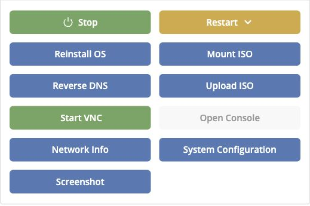
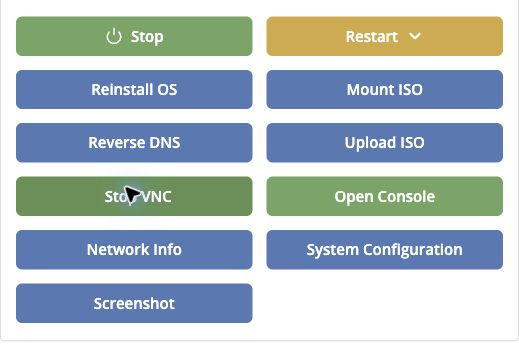

## Open the VPS console

VNC lets you see the VPS display and use its keyboard even when SSH or RDP is unavailable. **Open Console** launches noVNC in your browser; a desktop VNC client is another option.

1. Open the [VPS Management Portal](https://manage.edisglobal.com/clientarea.php).
2. Select **Services → My Services**, open your VPS, and select **Server Information**.
3. In **Server management**, click **Start VNC**.
4. Wait for **VNC: ENABLED** in the **Information** panel and for **Open Console** to become available.
5. Click **Open Console**, then click inside the console window to give it keyboard focus.

<Frame caption="To enable VNC, click Start VNC in Server management.">
  
</Frame>

<Frame caption="When VNC is enabled, Open Console becomes available.">
  
</Frame>

## Can I copy and paste text?

**The EDIS Global browser console (noVNC) does not support clipboard transfer between your computer and the VPS.** Click inside the console and type directly if you need to enter text there.

**Desktop VNC clients support text copy and paste** when clipboard sharing is enabled in the client and the guest session supports it. Clipboard sharing may be unavailable at a login prompt, in a text-only console, or during boot.

## Log in through the browser console

At the operating system's login screen, use your Linux or Windows username and password. The separate **VNC password** is for desktop VNC connections; it is not your operating-system password and is not required to open the browser console.

## Connect with a desktop VNC client

With VNC enabled, the **Information** panel shows the VNC hostname, port and password. Enter the VNC hostname and port shown there in your desktop client. When the client asks for a password, enter the VNC password from the panel. Once connected, use your operating-system credentials at the VPS login screen.

## Stop VNC when finished

Close the console or desktop client and click **Stop VNC** in the portal. The panel returns to **VNC: DISABLED** and **Open Console** becomes unavailable. Stopping VNC disconnects console access; it does not stop the VPS.
